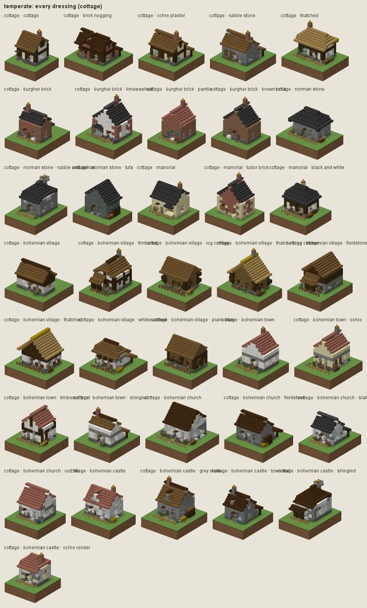
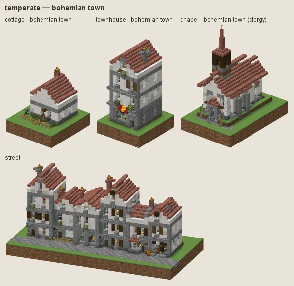
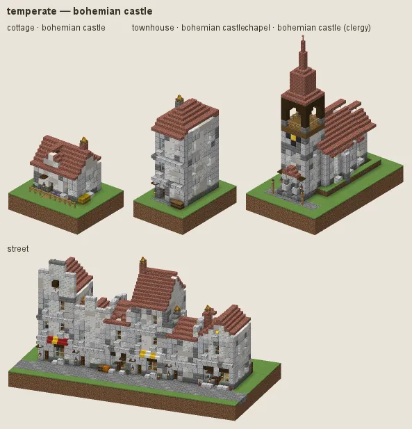
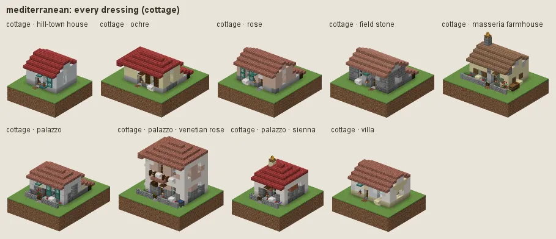
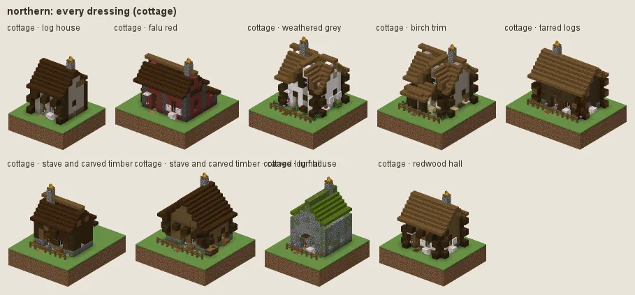
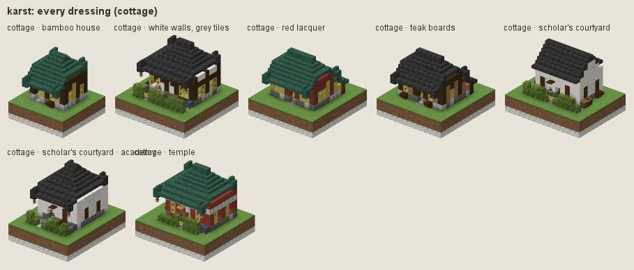

# `hearth/` — VOID Hearth

Living settlements for **Minecraft 26.3** (Fabric): villages, towns and castles whose folk build and grow them
while you play and while you are away, with coin struck at their mints, quests that come from what a town needs,
a Kingdom Come: Deliverance style law with stealth and reputation, and an economy that runs on the land around
each town.

```
Fabric Loader ≥ 0.19.5 · Fabric API 0.161.0+26.3 · Java 25 · optional: VOID Expanse, VOID LOD
```

Work in progress (version 0.1.0). Phases 1–3 and architecture stages A and B are built and merged; what is left is
listed in [docs/ARCHITECTURE.md](docs/ARCHITECTURE.md) §14.

## The buildings

| | |
|---|---|
|  **Temperate**, the Bohemian look |  A Bohemian market-town house |
|  A Bohemian castle |  **Mediterranean** hill-town houses |
|  **Northern** log and stave timber |  **Karst** bamboo and courtyards |

These are blueprint previews, rendered offline by `./gradlew blueprintPreview` (see *Previews* below); the full
set, one page per culture, is in [docs/buildings/styles/](docs/buildings/styles/README.md).

## What's in it

### Settlements that live and grow

A settlement is data first: plots, residents, a stockpile, a treasury and a history. The sim steps it cheaply as
numbers while nobody is near, and what its builders raised is written into the world when a player arrives. Entities
and block changes are made only where someone can see them, and the abstract and embodied versions of everything
give the same results.

- **A history from the seed.** The atlas gives the world its settlements from the world seed alone, so a town you
  find on day 1 already has a past. Founding, layouts (crossroads, hillside, walled, farmsteads, deep towns under
  Expanse's realms...) and growth from camp to city are decided by the planner (`plan/`), which follows the land:
  switchbacks and terraces up slopes, stilts over water, bridges, walls, towers.
- **Builders really build.** Embodied builders raise a plot step by step with scaffolding; away from the player the
  same steps are paid for in the stockpile and written in the record.
- **Decay and change.** Empty houses weather and fall; households add rooms; markets, festivals, weddings and
  funerals dress the fronts.

### Folk

Hearthfolk have names, trades, personalities, families and routines: they wake, eat, work, gather, go home and sleep.
They die permanently, and can be murdered. Builders, farmers, foresters, quarriers, miners, millers, bakers,
fishers and haulers do their work in the world; couriers and caravans walk the roads between towns. Guards and
witnesses are behaviours the law module teaches them. See [docs/FOLK.md](docs/FOLK.md).

### Coin and the economy

Money is physical, from Minecraft's own metals: **copper bits, iron marks and gold crowns** (1, 10 and 100 bits),
carried in a coin pouch. Players cannot craft coin; it enters by wages, trade and quest rewards from settlement
treasuries. Every shop keeps its own stock and till, residents have purses and earn wages, and goods are bought and
sold at prices that follow supply, with haggling and fences for stolen goods. Towns thrive on what is around them:
a territory survey finds stone, ore, clay, timber, fertile and pasture land; excavations (quarries, mines, pits) are
construction run backwards; gatherers and haulers feed production chains (log to sawn timber, ore to ingot to
tool); caravans trade between towns; boom and bust follow the stockpile. See [docs/ECONOMY.md](docs/ECONOMY.md)
and [docs/SIM.md](docs/SIM.md).

### Quests

Quests come from what a settlement needs: stone for a stalled bridge, ore for a short smithy, a parcel or a pack
mule to lead, a landmark rubbing for the scholars, a bounty on what presses on the town at night, help in a fire or a
mine collapse. Finishing them visibly changes the town. See [docs/QUESTS.md](docs/QUESTS.md).

### Law and stealth

Everything in a settlement belongs to someone, and a crime counts only if someone sees it or finds it out later.
Witnesses run to the guard, guards confront you, and you pay, go to the cell or the pillory, talk, bribe, run or
fight. Bounties follow you to the next town, with wanted posters on the notice boards; an unpaid murder makes you an
outlaw. Stealth is a playstyle: sneaking in the dark, lockpicking and pickpocketing, each with a minigame; locks and
keys; stolen goods and fences. See [docs/LAW.md](docs/LAW.md).

### Reputation and town life

Reputation is per settlement, layered with each resident's personal opinion and regional fame that travels as gossip,
with titles, charisma and menace, speech checks and optional companies of players who share standing
([docs/STANDING.md](docs/STANDING.md)). Towns keep a calendar: market days, bells, festivals, weddings, funerals and
births on the notice board; a reeve, a guard captain, a priest, a master builder, a lord; inns, bathhouses and
stables; work for wages; dice in the tavern ([docs/SOCIAL.md](docs/SOCIAL.md)).

### Repairs

A building's blueprint is the truth, so damage is the difference between a built plot and the world. The repair
module notices it, queues it, and mends it with embodied or abstract labour; fires are fought with a bucket brigade;
vandalism is reported to the law ([docs/REPAIRS.md](docs/REPAIRS.md)).

### The building catalogue

About 140 building types in 14 cultures, each with sub-styles: homes from huts to manors, town houses and
tenements, farmsteads, workshops and mills, mines and quarries, markets and inns, civic halls, courthouses, jails,
schools and monasteries, castles and cathedrals, walls and gatehouses, bridges and docks, and underground towns.
Every building is generated from a blueprint (a plot spec and a seed give the same building every time), is
furnished, and holds the light rule: interiors are lit to at least 8, so nothing ships dark.

| Culture | Manners |
|---|---|
| temperate | Bohemian village, town, church and castle (the main look, after *Kingdom Come: Deliverance II*); English cottage, burgher brick, Norman stone, manorial |
| wisteria, northern, alpine, tundra, moorland, maritime | woodland, log and stave, chalet, longhouse, rubble and kirk, harbour |
| tropical, desert, mediterranean, steppe, karst, bayou, mesa | stilts and coral stone, adobe and sandstone, hill town and palazzo, round houses, bamboo courtyards, creole galleries, pueblo |

The surface looks natural and real-world: no glowing or fantasy blocks above ground. Fantasy belongs underground
only. Both are held by tests, not just by habit.

## With VOID Expanse and VOID LOD

Hearth is the third of three mods that share one world. Each owns its part:

| | Owns |
|---|---|
| **Hearth** | villages, towns, castles and keeps, every worked building (mills, kilns, quarries, mines, smithies, farms), and the roads in and between settlements |
| **[VOID Expanse](../expanse/README.md)** | the land between: terrain, foliage and understory, hedgerows, wild features, ruins and small wayside sights |
| **[VOID LOD](../lod/README.md)** | far terrain past the render distance |

With Hearth installed, its settlements replace the world's static villages: every structure set made only of
`#minecraft:village` structures (vanilla's, Expanse's seven regional villages, any mod's) is left out of structure
generation. Expanse's landmarks (Frostwatch Citadel, Palm Harbour...) stay as remote, unpeopled places to quest to. Set
`"replace_villages": false` in `config/hearth/villages.json` to keep the old villages. Hearth keeps its planned land
clear of Expanse's structures; Expanse asks Hearth through a land-claims hook before placing anything with a
footprint.

Hearth reads Expanse's Earth terrain model directly for rivers, coasts and landforms, builds with Expanse woods and
stones where they suit, and sends quests to Expanse landmarks and realms. It runs without Expanse, on a generic
terrain probe. For LOD, the sim exposes built plots as read-only silhouettes (`sim/LodFootprints`); the LOD does not
draw them yet.

## Build

```sh
cd hearth
JAVA_HOME=<jdk 25> ./gradlew build      # → build/libs/void-hearth-<version>.jar; about 13 min with 2,000+ tests
```

On Windows the repo's `scripts/setup-dev.ps1` installs Java 25 under `.tools/`. `./gradlew runClient` starts the game
with Hearth and Expanse from source, and `./gradlew runClientGameTest` runs the client game tests (a tour of
settlements by day and night). Test in the client: there is no dedicated-server run.

## Try it in game

Make a new Expanse Earth world (with Hearth installed, settlements are laid out by the seed's atlas as chunks
generate), or found one where you stand. The dev commands need permission level 2 (cheats on):

| Command | What it does |
|---|---|
| `/hearth settlement list`, `info [id]`, `tp <id>` | the settlements of the world, a report on one, teleport |
| `/hearth settlement found [culture]` | found a settlement where you stand |
| `/hearth settlement simulate <id> <days>` | run its history forward |
| `/hearth settlement adopt`, `sites`, `economy`, `survey` | make the region you stand in real now (its atlas settlement); resource sites, economy and territory survey |
| `/hearth atlas [radius]` | map the settlements of a region |
| `/hearth sim stats`, `/hearth sim embody <id>` | timings; make a town's folk and buildings real now |
| `/hearth plot info`, `/hearth plan info` | the plot and the planner's state where you stand |
| `/hearth build <archetype> [style] [seed] [frontage] [depth] [storeys]`, `/hearth build undo` | place a single blueprint in front of you; undo it |
| `/hearth npc spawn [job] [culture] [age]`, `info`, `stats`, `behaviours`, `escort`, `station`, `caravan send` | spawn and inspect folk |
| `/hearth npc sandbox [clear \| build cottage\|tower\|quarry]` | a small test camp with builders, without a world |
| `/hearth money give\|take <player> <amount>` | coin (amounts are in bits) |
| `/hearth market prices\|shops\|purses\|open`, `/hearth economy sandbox ...` | the market of the settlement you are in |
| `/hearth quest list\|board\|give\|complete\|abandon\|templates\|sandbox\|happen\|contracts ...` | drive quests |
| `/hearth law status\|wanted` (everyone); `pardon`, `bounty`, `crime`, `jail`, `pillory`, `release`, `lock`, `key`, `picks`, `reload` | law and stealth |
| `/hearth standing show\|set\|deed\|opinions\|gossip`, `/hearth company form\|invite\|join\|leave\|list\|info` | reputation and companies |
| `/hearth repair quote\|pay\|status\|list\|inspect\|mend\|stats` | repairs |
| `/hearth social events\|notices\|offices\|status\|force\|bell\|day\|dice` | town life |
| `/hearth caravans`, `/hearth underground` | caravans on the road; deep towns |

System properties of the form `hearth.dev.<module>.*` (for example `hearth.dev.found`, `hearth.dev.simulate`,
`hearth.dev.living`) drive the dev harness at start-up; they are listed where each module reads them.

### Previews

Offline renders, written to `build/previews/` without starting the game:

```sh
./gradlew blueprintPreview -Parchetype=<id|all> -Pstyle=<culture|all> -Pseeds=2 -Pterrain=<kind>
./gradlew settlementPreview -Pculture=<culture>[/<layout>] -Pdays=300 -Pterrain=<kind> -Pseed=<n>
```

`terrain` is a synthetic ground: flat, slope, steep, hills, cliff, river, coast or lake. The building families add
their own tasks (`agePreview`, `craftPreview`, `deepTown`, `extractionPreview`, `socialPreview`, `stationPreview`, `streetPreview`, `styleSheets`...) from
`docs/buildings/*_preview.gradle`.

## Config

Each module reads `config/hearth/<name>.json` at start-up and writes it with the defaults the first time, so the
file to edit is already there. Every field is optional, so an old file keeps working when fields are added.

| File | Holds |
|---|---|
| `sim.json` | the dimensions Hearth runs in, embodiment radius, clock, applier, atlas density, labour, production, storage, resources |
| `plan.json` | the planner's tuning (see PLANNING.md, *Tuning*) |
| `npc.json` | folk caps, spawn and behaviour rules |
| `economy.json` | base prices, service tariffs, wages, melting yield |
| `quest.json` | the quest module's settings |
| `law.json` | every rule of the law: fines, jail time, witnesses, bounties (`/hearth law reload` rereads it) |
| `standing.json` | reputation, gossip, charisma |
| `repair.json` | repair settings |
| `social.json` | the calendar and town-life times |
| `villages.json` | `replace_villages` (default true) |

## The docs

Start with [docs/ARCHITECTURE.md](docs/ARCHITECTURE.md), the contract between the modules and the phase list.

| Read | For |
|---|---|
| [LIVING_WORLD.md](docs/LIVING_WORLD.md) | the phase 3 design: light, repairs, reputation, law, the resource economy, more architecture |
| [SIM.md](docs/SIM.md), [PLANNING.md](docs/PLANNING.md) | the engine (records, clock, atlas, embodiment) and the planner |
| [FOLK.md](docs/FOLK.md), [ECONOMY.md](docs/ECONOMY.md), [QUESTS.md](docs/QUESTS.md) | folk, coin and shops, quests |
| [LAW.md](docs/LAW.md), [STANDING.md](docs/STANDING.md), [SOCIAL.md](docs/SOCIAL.md), [REPAIRS.md](docs/REPAIRS.md) | law and stealth, reputation, town life, repairs |
| [BUILDING_GUIDE.md](docs/BUILDING_GUIDE.md) | how a blueprint is made and how to write an archetype that looks handbuilt |
| [buildings/](docs/buildings/) | the catalogue, one page per family (homestead, townhome, trade, civic, noble, craft, deep...) |
| [buildings/styles/](docs/buildings/styles/README.md) | the style bible: one page per culture, with renders |
| [requests/](docs/requests/) | what each module asked of the others, and what is still open |
