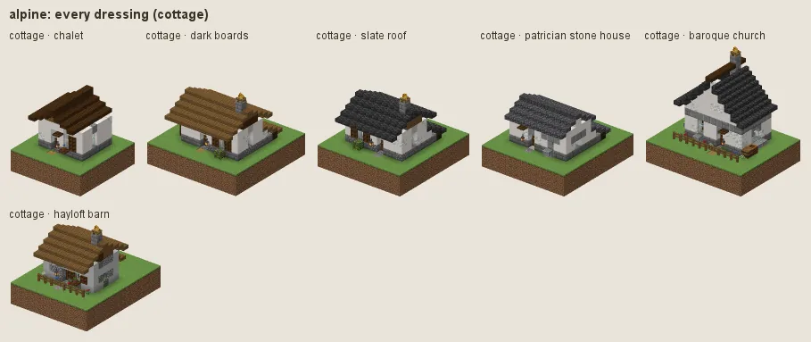
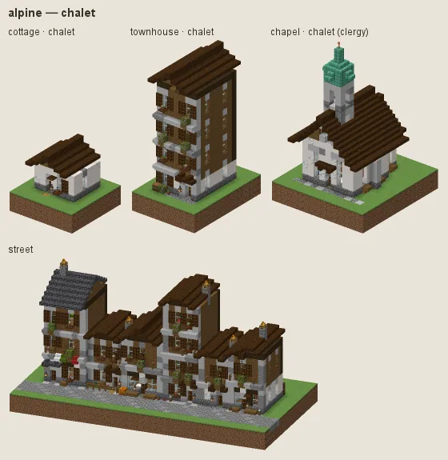
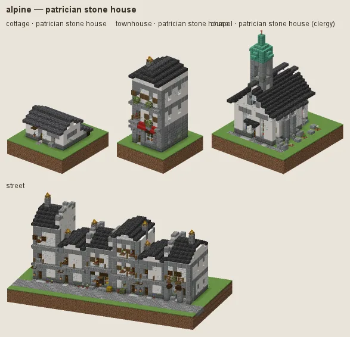
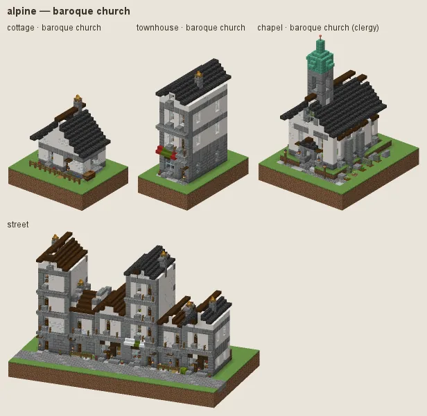
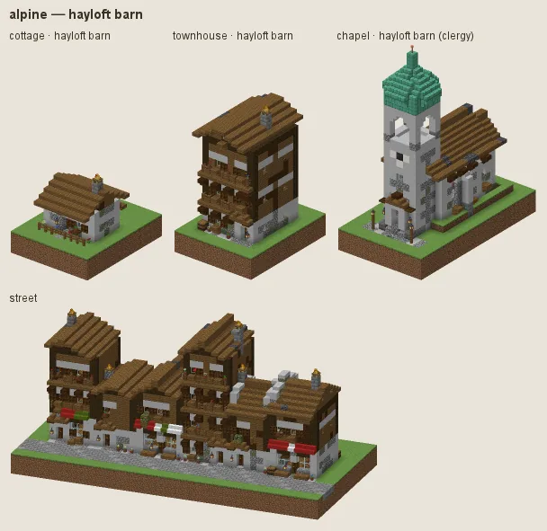

# Alpine: chalets on a white stone storey

The Alps and the Tatras: chalets with a whitewashed stone ground storey and dark boarded timber above, low slab roofs with deep eaves and balconies, flower boxes, patrician stone houses in the towns, white baroque churches with onion towers, and hayloft barns of fieldstone and boards.

## Manners

| dressing | worn by | walls | roof | built as |
|---|---|---|---|---|
| **chalet** (common manner, w 2) | not (station gentry / lord or category religious) | smooth quartz, calcite | dark oak, cobbled deepslate | plaster under plank |
| · dark boards (w 1) | as the common manner | · | spruce | plaster under plank |
| · slate roof (w 1) | as the common manner | · | deepslate tiles, cobbled deepslate | plaster under plank |
| **patrician stone house** (sub-style, w 8) | station merchant / official / gentry / lord or category trade / public, not (category religious) | smooth quartz, calcite | deepslate tiles, cobbled deepslate | plaster |
| **baroque church** (sub-style, w 6) | category religious | smooth quartz, calcite | dark oak, deepslate tiles | plaster |
| **hayloft barn** (sub-style, w 4) | category farmstead / storage or station poor | cobblestone, stone, mossy cobblestone | spruce, cobbled deepslate patches | stone under plank |

A dash (·) keeps the material of the manner above. Weights compete among the dressings whose conditions hold (README §2).

### Chalet

White render under boarded dark timber (plaster under plank), gable fronts, deep eaves, balconies and flower boxes, dark oak or cobbled-deepslate roofs. Fashions: **dark boards**, **slate roof**.

### Patrician stone house

For merchants, officials and the gentry: rendered stone to the eaves, slate roofs, painted window surrounds.

### Baroque church

White render with grey dressings, dark roofs; the archetypes give alpine towers onion domes.

### Hayloft barn

Farmsteads, stores and the poor: fieldstone below, boards above, shingles.

## Finish by station and tier

Tier 0 builds the ground storey in rough cobblestone; tier 3 roofs in slate and dark oak.

## Local materials

Local stone goes into the ground storey and footings, local timber into the boarding.

---

Renders: `./gradlew -I docs/buildings/styles/styles_preview.gradle styleSheets -Pmode=dress -Pstyle=alpine` (every dressing), `-Pmode=stations`, `-Pmode=street`, `-Pmode=set`. Data: `src/main/resources/data/hearth/hearth_style/alpine.json`.
