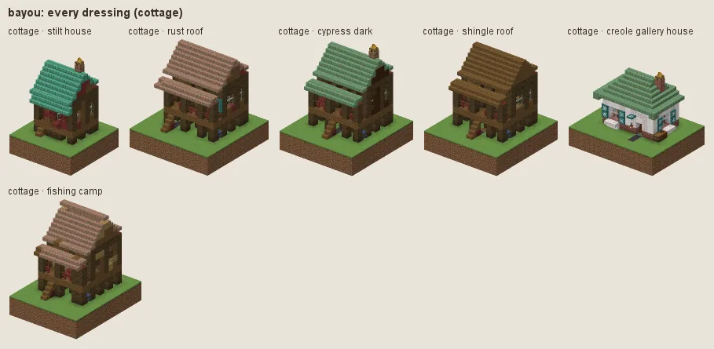
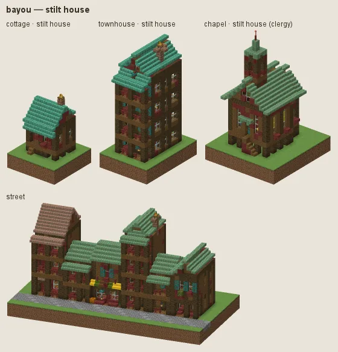
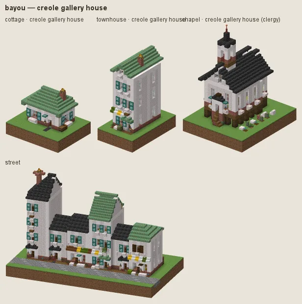
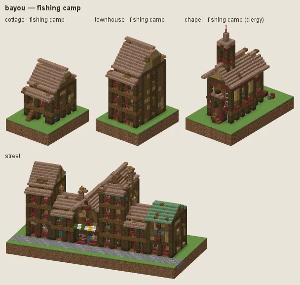

# Bayou: board-and-batten on stilts

The Louisiana bayou and the muskeg: board-and-batten stilt houses of willow (spruce in previews) and mangrove under rusted tin (weathered copper), deep galleries, hanging moss; pale creole gallery houses for the better-off; fishing camps.

## Manners

| dressing | worn by | walls | roof | built as |
|---|---|---|---|---|
| **stilt house** (common manner, w 2) | not (station gentry / lord or category religious) | spruce, mangrove | weathered cut copper, oxidized cut copper, exposed cut copper | plank |
| · rust roof (w 1) | as the common manner | · | exposed cut copper, cut copper | plank |
| · cypress dark (w 1) | as the common manner | dark oak | · | plank |
| · shingle roof (w 1) | as the common manner | · | spruce | plank |
| **creole gallery house** (sub-style, w 8) | station merchant / official / gentry / lord / clergy or category religious / public | pale oak, birch | deepslate tiles, weathered cut copper | plank |
| **fishing camp** (sub-style, w 3) | station poor or archetype work/fishery / infra/dock | spruce, oak, mangrove | exposed cut copper, weathered cut copper, spruce patches | plank |

A dash (·) keeps the material of the manner above. Weights compete among the dressings whose conditions hold (README §2).

### Stilt house

Boards on stilts under weathered and oxidized copper. Fashions: **rust roof**, **cypress dark**, **shingle roof**.

### Creole gallery house

For merchants, officials, the gentry, the clergy and public buildings: pale boarded walls, deep galleries, slate and copper roofs.

### Fishing camp

For the poor, the fishery and the docks: mixed salvaged boards under rusted tin.

## Finish by station and tier

Tier 0 is mixed boards under exposed copper and spruce; tier 3 roofs in slate.

## Local materials

Local timber into boards and stilts. Working yards (category workshop) fell dark oak, not red mangrove.

---

Renders: `./gradlew -I docs/buildings/styles/styles_preview.gradle styleSheets -Pmode=dress -Pstyle=bayou` (every dressing), `-Pmode=stations`, `-Pmode=street`, `-Pmode=set`. Data: `src/main/resources/data/hearth/hearth_style/bayou.json`.
