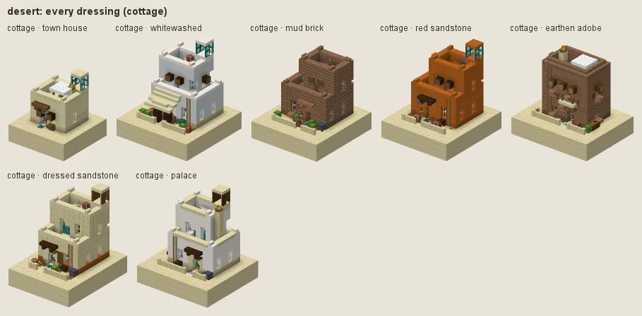
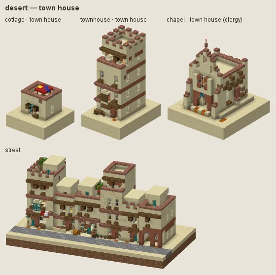
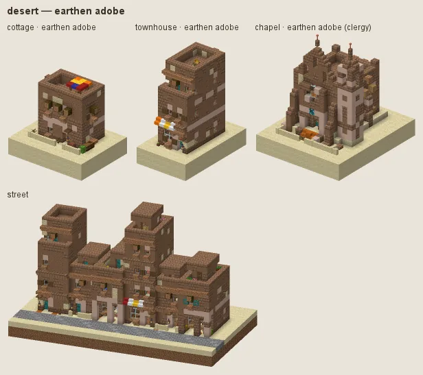
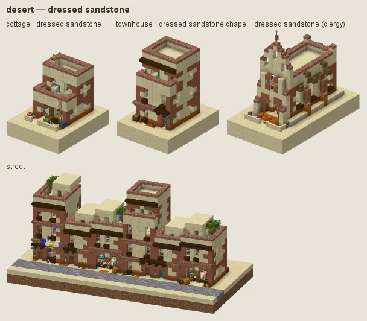
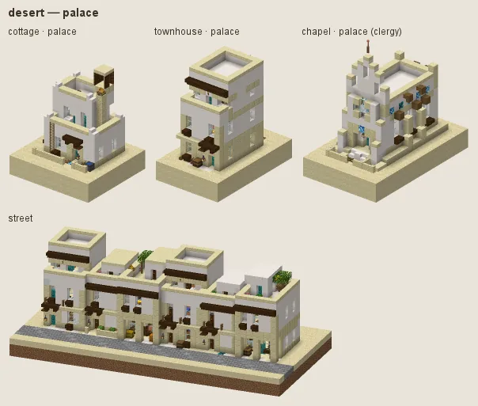

# Desert: sandstone and adobe

North Africa and the Middle East: sandstone and adobe houses under flat roof terraces with parapets, red-banded walls, dark timber beams through the wall heads, blue doors, tile and awnings; earthen adobe for the poor and the workshops; dressed sandstone for merchants and public buildings; white palaces with domes.

## Manners

| dressing | worn by | walls | roof | built as |
|---|---|---|---|---|
| **town house** (common manner, w 2) | not (station gentry / lord) | smooth sandstone, sandstone, packed mud | smooth sandstone, sandstone | adobe |
| · whitewashed (w 1) | as the common manner | white concrete, smooth quartz | · | adobe |
| · mud brick (w 1) | as the common manner | mud bricks, packed mud | packed mud, mud bricks | adobe |
| · red sandstone (w 0.8) | as the common manner | smooth red sandstone, red sandstone | smooth red sandstone | adobe |
| **earthen adobe** (sub-style, w 5) | station poor / peasant or category farmstead / workshop | packed mud, mud bricks, sandstone | packed mud, mud bricks | adobe |
| **dressed sandstone** (sub-style, w 8) | station merchant / official / clergy / scholar or category public / trade, tier 2+ | cut sandstone, smooth sandstone |  | stone |
| **palace** (sub-style, w 8) | station gentry / lord or category grand / noble | smooth quartz, white concrete, calcite | smooth quartz, smooth sandstone | plaster |

A dash (·) keeps the material of the manner above. Weights compete among the dressings whose conditions hold (README §2).

### Town house

Smooth sandstone with sandstone at the foot and packed-mud patches, flat roofs and parapets, terracotta bands, spruce vigas. Fashions: **whitewashed** (with blue painted doors and shutters), **mud brick**, **red sandstone**.

### Earthen adobe

For the poor, farmsteads and workshops: packed mud and mud brick, battered walls, flat mud roofs.

### Dressed sandstone

For merchants, officials, the clergy, scholars and public and trade buildings: cut and smooth sandstone, dressed corners.

### Palace

For the gentry and grand buildings: white render (quartz, concrete, calcite), domes in turquoise tile.

## Finish by station and tier

Tier 0 is all packed mud and mud brick; tier 3 dresses plinths and paving in cut sandstone.

## Local materials

Local stone graded into plinths and dressings.

## Still weak

Turquoise tile domes use prismarine bricks: a real-world glaze colour, not a glowing block.

---

Renders: `./gradlew -I docs/buildings/styles/styles_preview.gradle styleSheets -Pmode=dress -Pstyle=desert` (every dressing), `-Pmode=stations`, `-Pmode=street`, `-Pmode=set`. Data: `src/main/resources/data/hearth/hearth_style/desert.json`.
