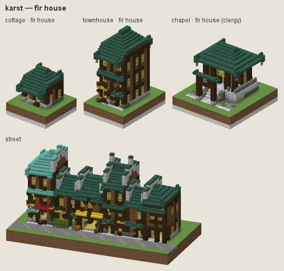
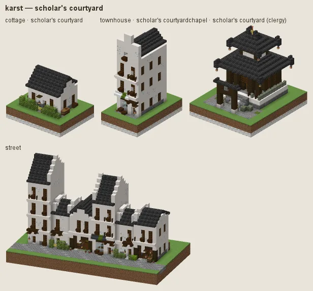
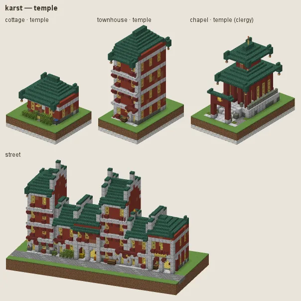

# Jade Karst: fir boards, dark timber and green tile

South China and Vietnam among the limestone towers: fir boards in dark timber frames on limestone sills, rammed earth for the poor, bamboo for screens, doors and fences, sweeping roofs of green-glazed tile with lifted corners, lattice windows; scholar-gentry courtyard houses in white walls under grey tile; red temples.

## Manners

| dressing | worn by | walls | roof | built as |
|---|---|---|---|---|
| **fir house** (common manner, w 2) | not (station gentry / lord / scholar or category religious) | spruce (fir) boards | dark prismarine, prismarine bricks | bamboo |
| · white walls, grey tiles (w 1.2) | as the common manner | smooth quartz, calcite | deepslate tiles | timber frame |
| · red lacquer (w 1) | as the common manner | · | · | bamboo |
| · teak boards (w 0.8) | as the common manner | jungle | deepslate tiles | plank |
| **scholar's courtyard** (sub-style, w 8) | station scholar / gentry / lord / official / merchant or archetype house/courtyard_house / civic/library / civic/school / civic/town_hall | smooth quartz, calcite | deepslate tiles, cracked deepslate tiles | brick |
| · academy (w 2) | category public | · | · | brick |
| **temple** (sub-style, w 8) | category religious | red terracotta, terracotta | dark prismarine, prismarine bricks | plaster |

A dash (·) keeps the material of the manner above. Weights compete among the dressings whose conditions hold (README §2).

### Fir house

Fir boards (spruce) between dark oak posts on a stone sill, bamboo doors, shutters and fences, pagoda roofs of green-glazed tile (dark prismarine). Fashions: **white walls, grey tiles**, **red lacquer**, **teak boards**.

### Scholar's courtyard

For scholars, the gentry, officials and merchants and the courtyard house, library, school and town hall: white walls under grey tile round a court. Fashion: **academy** (public buildings).

### Temple

Red walls, green tile, carved stone.

## Finish by station and tier

Tier 0 is rammed earth (packed mud) under oak-brown thatch; tier 3 has dark railings and carved limestone.

## Local materials

Local stone into sills and platforms. Working yards (category workshop: logging camp, charcoal burners, sawmill, woodlot) fell and plant fir (spruce), not cherry: the pink billets and blossom woodlot (audit L7 item 3).

No bamboo planks as a wall (audit L7: lemon-yellow walls); bamboo stays in screens, doors, fences and trim.

## Still weak

Green-glazed tile uses dark prismarine: a real glaze colour, not a glowing block.

---

Renders: `./gradlew -I docs/buildings/styles/styles_preview.gradle styleSheets -Pmode=dress -Pstyle=karst` (every dressing), `-Pmode=stations`, `-Pmode=street`, `-Pmode=set`. Data: `src/main/resources/data/hearth/hearth_style/karst.json`.
