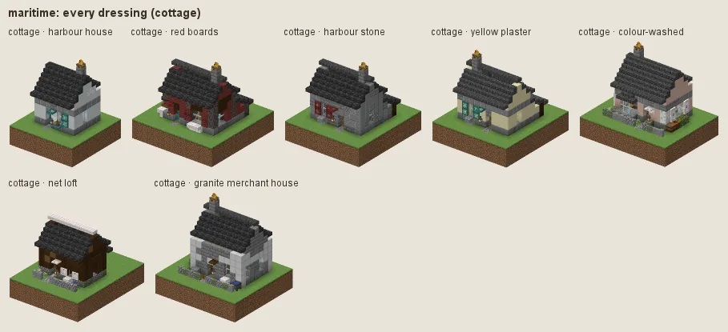
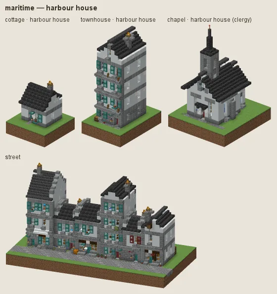
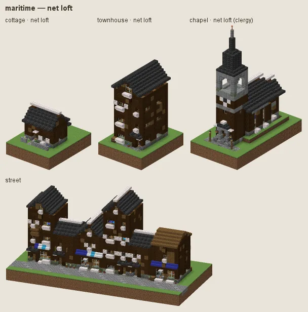
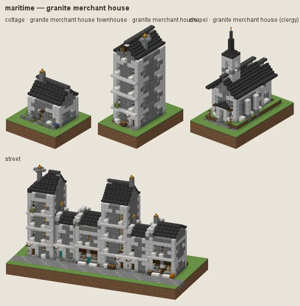

# Maritime: whitewashed harbour houses

Atlantic fishing towns (Brittany, Cornwall, Newfoundland): whitewashed houses on grey stone under slate, painted shutters, tarred net lofts on the quays, granite merchant houses.

## Manners

| dressing | worn by | walls | roof | built as |
|---|---|---|---|---|
| **harbour house** (common manner, w 2) | not (station gentry / lord) | white concrete, calcite, smooth quartz | deepslate tiles, polished deepslate | plaster |
| · red boards (w 1) | as the common manner | mangrove | · | plank |
| · harbour stone (w 1) | as the common manner | stone bricks, cobblestone, andesite | · | stone |
| · yellow plaster (w 0.8) | as the common manner | smooth sandstone | · | plaster |
| · colour-washed (w 0.8) | as the common manner | white terracotta, calcite | · | plaster |
| **net loft** (sub-style, w 6) | archetype work/fishery / storage/* / work/sawmill / work/carpentry or category workshop / storage, district harbour or category workshop / storage, landform coast | dark oak, spruce | deepslate tiles, spruce, moss block patches | plank |
| **granite merchant house** (sub-style, w 10) | station merchant / official / gentry / lord or archetype civic/town_hall / commerce/bank / commerce/inn / house/manor | stone bricks, polished andesite, mossy stone bricks | deepslate tiles, polished deepslate | stone |

A dash (·) keeps the material of the manner above. Weights compete among the dressings whose conditions hold (README §2).

### Harbour house

White render (white concrete, calcite, quartz) on a stone plinth, slate roofs, painted shutters. Fashions: **red boards**, **harbour stone**, **yellow plaster**, **colour-washed** (pale pink-beige).

### Net loft

Fisheries, stores, sawmills and workshops by the harbour or the coast: tarred dark boards under slate and mossy shingles.

### Granite merchant house

Merchants, officials, the gentry, the town hall, bank, inn and manor: coursed grey stone under slate.

## Finish by station and tier

Tier 0 is cobble and white render under mossy spruce shingles; tier 3 has stone chimneys and a polished plinth.

## Local materials

Local stone graded into plinths and walls; the render stays white.

---

Renders: `./gradlew -I docs/buildings/styles/styles_preview.gradle styleSheets -Pmode=dress -Pstyle=maritime` (every dressing), `-Pmode=stations`, `-Pmode=street`, `-Pmode=set`. Data: `src/main/resources/data/hearth/hearth_style/maritime.json`.
