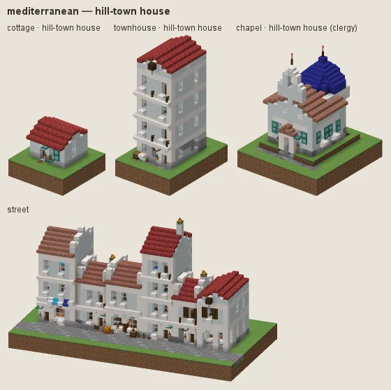
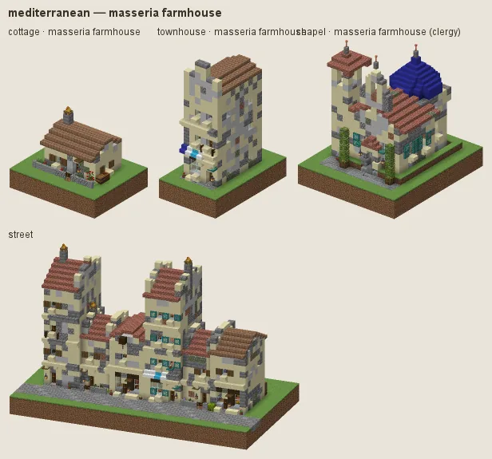
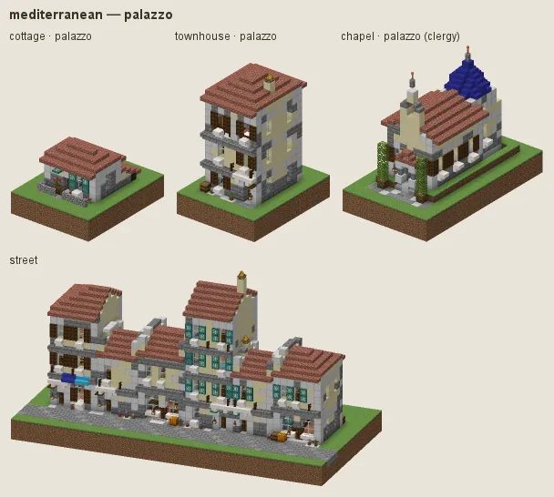
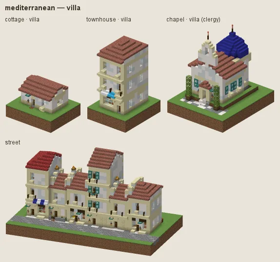

# Mediterranean: whitewash and terracotta

Italy, Provence, Greece and Spain: whitewashed stone houses under low terracotta roofs, arched windows, painted shutters, pots and olives; stone masserias in the fields; ochre and rose palazzi in the towns; white villas for the gentry.

## Manners

| dressing | worn by | walls | roof | built as |
|---|---|---|---|---|
| **hill-town house** (common manner, w 2) | not (station gentry / lord) | white concrete, smooth quartz, calcite | bricks, cinnabar bricks|bricks, polished granite | plaster |
| · ochre (w 1) | as the common manner | smooth sandstone, sandstone | · | plaster |
| · rose (w 0.8) | as the common manner | white terracotta | · | plaster |
| · field stone (w 1) | as the common manner | stone, cobblestone, andesite | · | stone |
| **masseria farmhouse** (sub-style, w 5) | station poor / peasant or category farmstead | stone, smooth sandstone, cobblestone | bricks, mud bricks, mossy cobblestone patches | stone |
| **palazzo** (sub-style, w 10) | station merchant / official or archetype civic/town_hall / commerce/bank / commerce/market_hall / civic/library | smooth sandstone, sandstone | bricks, cinnabar bricks|bricks | stone |
| · venetian rose (w 1) | as palazzo | white terracotta | · | stone |
| · sienna (w 0.7) | as palazzo | terracotta, orange terracotta | · | stone |
| **villa** (sub-style, w 8) | station gentry / lord or archetype house/manor / noble/palace / noble/hunting_lodge | smooth quartz, white concrete | bricks, cinnabar bricks|bricks | plaster |

A dash (·) keeps the material of the manner above. Weights compete among the dressings whose conditions hold (README §2).

### Hill-town house

White render, low hipped and gabled terracotta roofs (brick, cinnabar brick, granite), arched windows, painted shutters. Fashions: **ochre**, **rose**, **field stone**.

### Masseria farmhouse

For the poor and farmsteads: rough stone and sandstone under tile.

### Palazzo

For merchants, officials and the civic buildings: ochre sandstone render with dressed corners. Fashions: **venetian rose**, **sienna**.

### Villa

For the gentry: white render under tile, loggias.

## Finish by station and tier

Tier 0 is rough stone under brick and mud-brick tile; tier 3 has glazed-tile accents and polished paving.

## Local materials

The culture renders its walls whatever stone lies under them (`habits.local.roles.wall = false`); local stone goes into footings, plinths and paving.

---

Renders: `./gradlew -I docs/buildings/styles/styles_preview.gradle styleSheets -Pmode=dress -Pstyle=mediterranean` (every dressing), `-Pmode=stations`, `-Pmode=street`, `-Pmode=set`. Data: `src/main/resources/data/hearth/hearth_style/mediterranean.json`.
