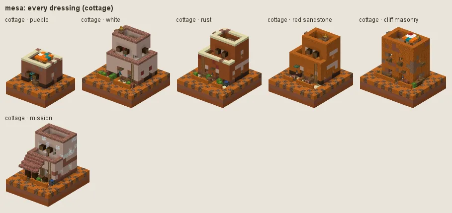
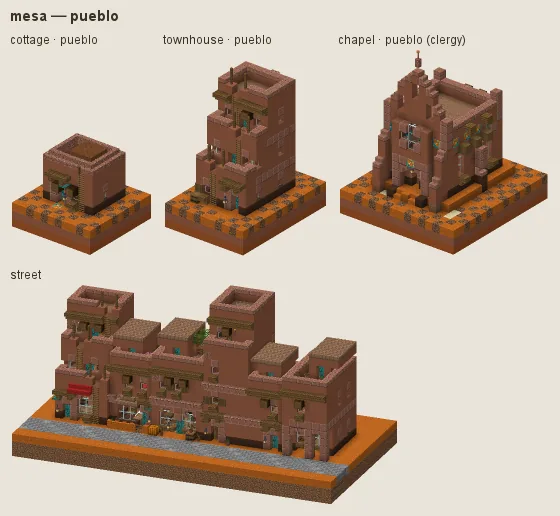
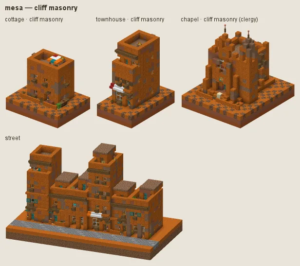
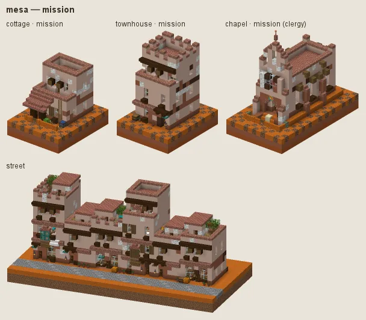

# Mesa: pueblos in earth and terracotta

The American Southwest: terraced adobe pueblos in earth and terracotta, dark vigas, turquoise doors, ladders and roof terraces; cliff masonry of red sandstone; white missions.

## Manners

| dressing | worn by | walls | roof | built as |
|---|---|---|---|---|
| **pueblo** (common manner, w 2) | not (category religious) | terracotta, a little granite, packed mud at the foot | mud bricks, packed mud | adobe |
| · white (w 1) | as the common manner | white terracotta | · | adobe |
| · rust (w 1) | as the common manner | orange terracotta, a little red terracotta | · | adobe |
| · red sandstone (w 1) | as the common manner | smooth red sandstone, red sandstone | · | adobe |
| **cliff masonry** (sub-style, w 4) | station poor / peasant or landform steep or category farmstead / storage | red sandstone, cut red sandstone, packed mud at the foot |  | stone |
| **mission** (sub-style, w 8) | category religious / grand or station gentry / lord / official | white terracotta, a little smooth sandstone, terracotta at the foot | bricks, mud bricks | adobe |

A dash (·) keeps the material of the manner above. Weights compete among the dressings whose conditions hold (README §2).

### Pueblo

Terracotta with a tonal patch of granite and packed mud at the foot, dressed in polished granite (smooth sandstone on the white fashion, smooth red sandstone on rust, cut red sandstone on red sandstone), flat roofs, spruce vigas. Fashions: **white**, **rust**, **red sandstone**.

### Cliff masonry

For the poor, steep ground, farmsteads and stores: red sandstone masonry.

### Mission

For churches, grand buildings, the gentry and officials: white terracotta render dressed in smooth sandstone, under tile.

**Walls (art review 2 item 6, audit L7).** Each dressing's wall is one material with at most a tonal second (under 10 %, in broad patches) and weathering only at the foot. Its `wall_accent` is one material, tonal with the wall but not the wall's own block: lintels, arch heads, quoins and copings are cut of it, so a contrasting accent dotted every window with a blotch (white on terracotta, terracotta and brown on white). No mixed accents.

## Finish by station and tier

Tier 0 is packed mud with mud-brick bands; tier 3 paves in smooth sandstone.

## Local materials

Local stone into masonry. Working yards (category workshop: logging camp, charcoal burners, sawmill, woodlot) fell spruce, not the grey-barked acacia.

---

Renders: `./gradlew -I docs/buildings/styles/styles_preview.gradle styleSheets -Pmode=dress -Pstyle=mesa` (every dressing), `-Pmode=stations`, `-Pmode=street`, `-Pmode=set`. Data: `src/main/resources/data/hearth/hearth_style/mesa.json`.
