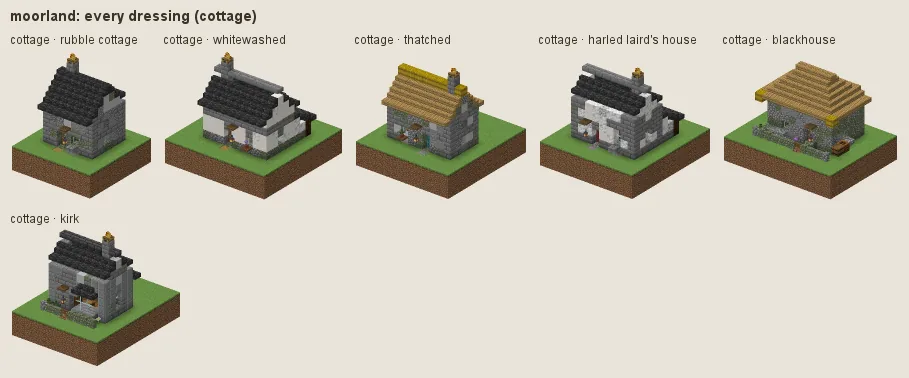
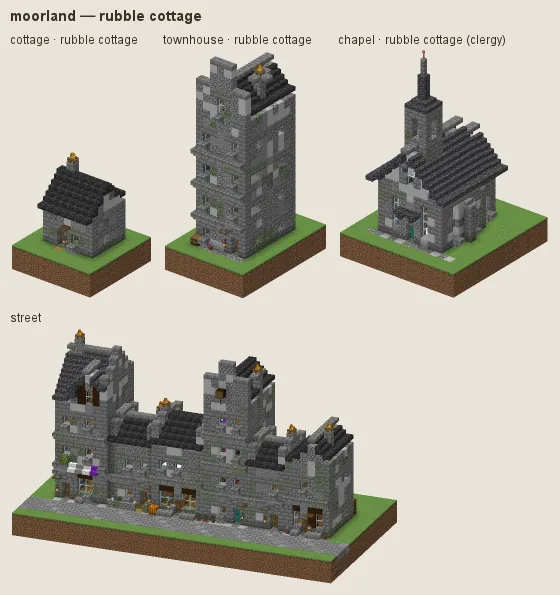
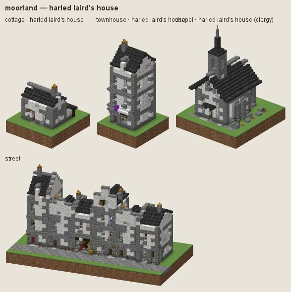
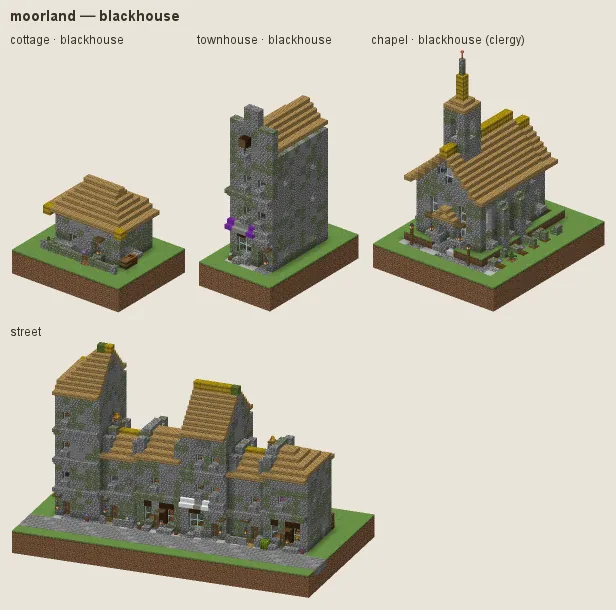
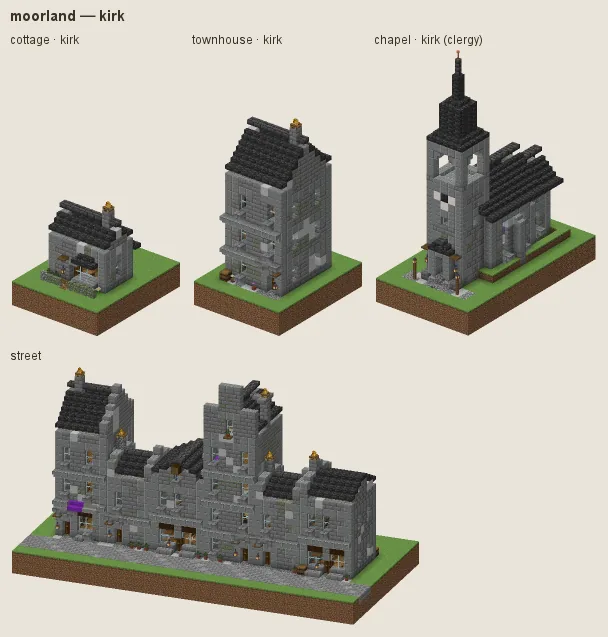

# Moorland: rubble cottages under heather thatch

Scotland, Wales and the Pennines: low rubble-stone cottages under heather thatch (slate for the better houses), dry-stone walls, heather; harled (white-rendered) laird's houses; blackhouses of rubble and thatch for the poor; stone kirks.

## Manners

| dressing | worn by | walls | roof | built as |
|---|---|---|---|---|
| **rubble cottage** (common manner, w 2) | not (station gentry / lord or category religious) | cobblestone, a little stone and andesite, moss at the foot | heather thatch (stripped spruce) | stone |
| · whitewashed (w 1) | as the common manner | smooth quartz, calcite | · | plaster |
| · slate roof (w 0.6) | as the common manner | · | deepslate tiles, cobbled deepslate | stone |
| **harled laird's house** (sub-style, w 8) | station merchant / official / gentry / lord or archetype civic/town_hall / house/manor / noble/* or category fort | calcite, smooth quartz, diorite | deepslate tiles, cobbled deepslate | stone |
| **blackhouse** (sub-style, w 4) | station poor / peasant or category farmstead | cobblestone, andesite, moss at the foot | heather thatch, mossy | stone |
| **kirk** (sub-style, w 6) | category religious | stone bricks, stone, mossy stone bricks | deepslate tiles, cracked deepslate tiles | stone |

A dash (·) keeps the material of the manner above. Weights compete among the dressings whose conditions hold (README §2).

### Rubble cottage

Cobblestone with a little stone, andesite and tuff, moss only at the foot, under a thick heather thatch (dark brown, rounded at the eaves, a full ridge). From above a lived-in house reads as a roof, told from a ruin's open stone gables at a glance (the live tour's Brackenthwaite read as roofless shells under dark slate on grey rubble). Fashions: **whitewashed** and **slate roof** (stone slates with coped gables, the better cottage).

### Harled laird's house

Merchants, officials, the gentry, the town hall and the defence works: white harling (calcite, a little quartz, diorite at the foot) on stone with pale diorite quoins, slate.

### Blackhouse

For the poor and farmsteads: rubble walls under thick hipped heather thatch with a few patches of moss.

### Kirk

Coursed stone, slate, arched windows.

## Finish by station and tier

Slate-roofed dressings roof tier 0 in rough cobbled deepslate (old stone slates); tier 0 builds window surrounds in cobble; tier 3 walls are coursed stone.

## Local materials

Local stone goes into everything that is stone, graded as the culture grades it. Palisades are dark spruce stakes (an override), never the birch bark of the garden trees. Working yards (category workshop) fell spruce (Scots pine), not birch.

---

Renders: `./gradlew -I docs/buildings/styles/styles_preview.gradle styleSheets -Pmode=dress -Pstyle=moorland` (every dressing), `-Pmode=stations`, `-Pmode=street`, `-Pmode=set`. Data: `src/main/resources/data/hearth/hearth_style/moorland.json`.
