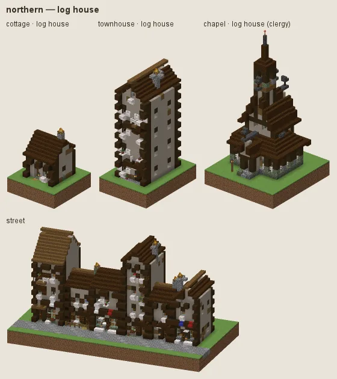
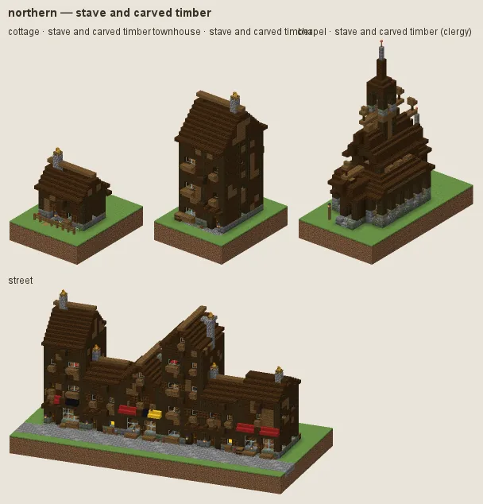
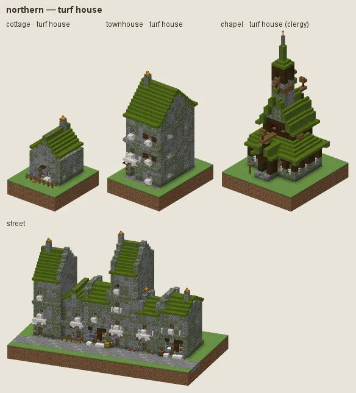
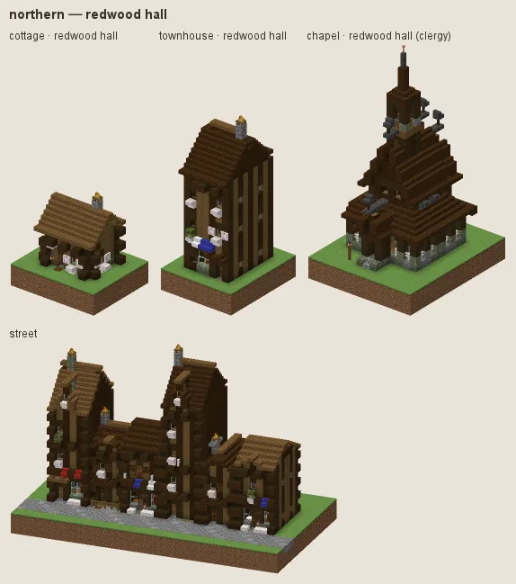

# Northern: silvered log halls

Scandinavian and Baltic timber building: log houses of weathered silver-grey timber (stripped poplar logs) on fieldstone, tar-black corners, dark shingle roofs with moss, white-painted window trim, deep eaves; Falu-red painted boards for the better farms; stave churches and carved halls for the important buildings; turf houses for the poor. In the Redwood Giants a whole manner of redwood halls.

## Manners

| dressing | worn by | walls | roof | built as |
|---|---|---|---|---|
| **log house** (common manner, w 2) | not (station gentry / lord or category religious) | poplar, spruce | dark oak, spruce, moss block patches | log |
| · falu red (w 1) | as the common manner | mangrove | dark oak, deepslate tiles | plank |
| · weathered grey (w 0.8) | as the common manner | pale oak, poplar | spruce, dark oak | log |
| · birch trim (w 1) | as the common manner | · | spruce | log |
| · tarred logs (w 0.8) | as the common manner | dark oak | spruce, moss block patches | log |
| **stave and carved timber** (sub-style, w 6) | category religious / grand or station gentry / lord or archetype civic/town_hall / commerce/inn | spruce | dark oak, spruce | plank |
| · carved log hall (w 1) | as stave and carved timber | spruce | · | log |
| **turf house** (sub-style, w 3) | station poor / peasant or category farmstead | cobblestone, mossy cobblestone, andesite | moss block | stone |
| **redwood hall** (sub-style, w 24) | biome expanse:redwood_giants | spruce | dark oak, spruce, moss block patches | log |

A dash (·) keeps the material of the manner above. Weights compete among the dressings whose conditions hold (README §2).

### Log house

Silver logs with dark corner notches, a fieldstone footing, dark oak shingles, white trim. Fashions: **falu red** (red-painted boards, white trim), **weathered grey** (pale oak and poplar), **birch trim** (white birch windows and doors), **tarred logs** (dark oak logs, spruce corners).

### Stave and carved timber

For churches, halls, the gentry, the town hall and the inn: boarded spruce walls on posts, dark stacked roofs, carved ridges. Fashion: **carved log hall**.

### Turf house

For the poor and farmsteads: fieldstone walls under turf roofs (moss over green wool stairs).

### Redwood hall

Only in the Redwood Giants (weight 24 there): halls of redwood (spruce in previews).

## Finish by station and tier

Tier 0 is rough spruce logs under mossy shingles; tier 3 roofs in slate with polished deepslate trim and stone chimneys.

## Local materials

A log culture takes local timber for its walls as hewn (stripped) logs; a light local wood never becomes the corners.

---

Renders: `./gradlew -I docs/buildings/styles/styles_preview.gradle styleSheets -Pmode=dress -Pstyle=northern` (every dressing), `-Pmode=stations`, `-Pmode=street`, `-Pmode=set`. Data: `src/main/resources/data/hearth/hearth_style/northern.json`.
