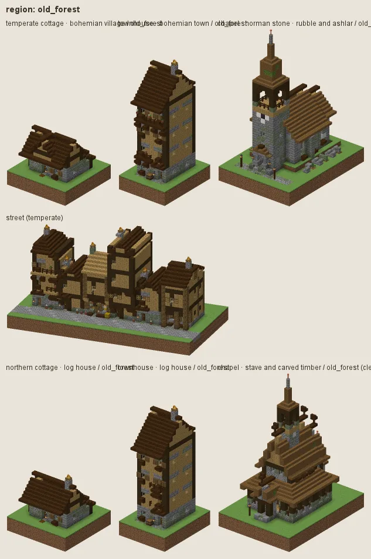
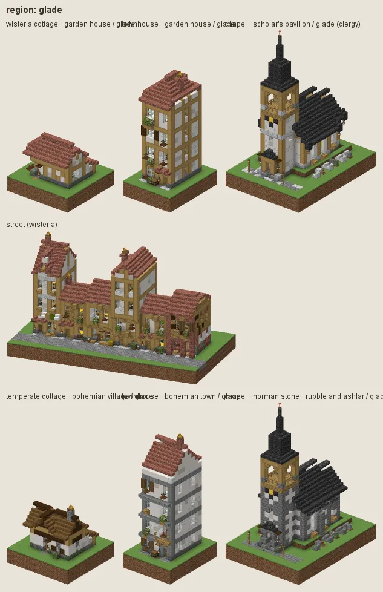
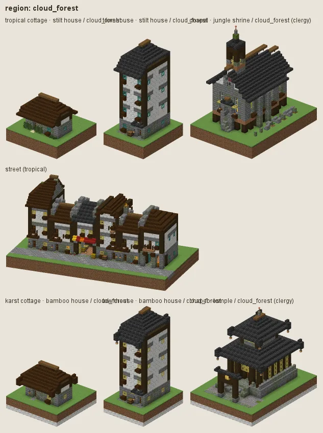
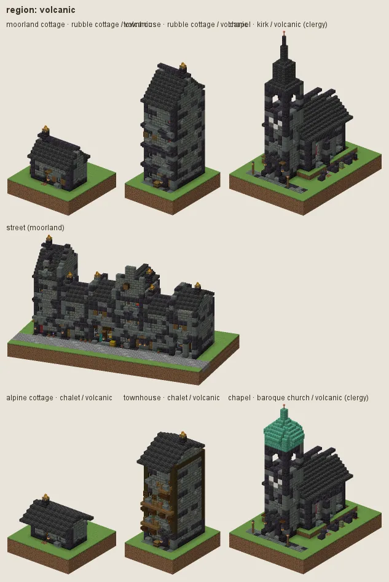
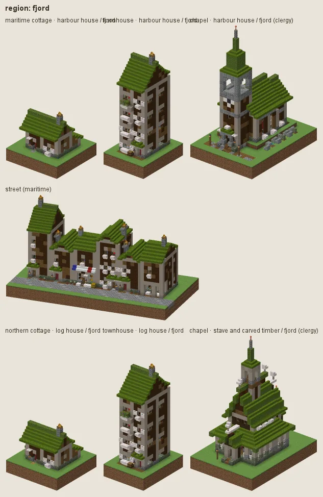
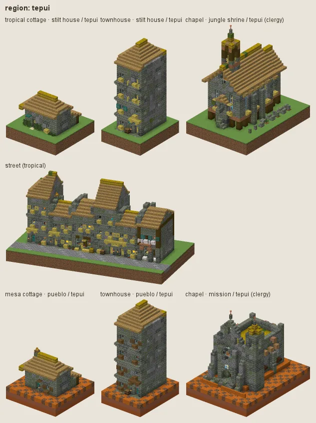
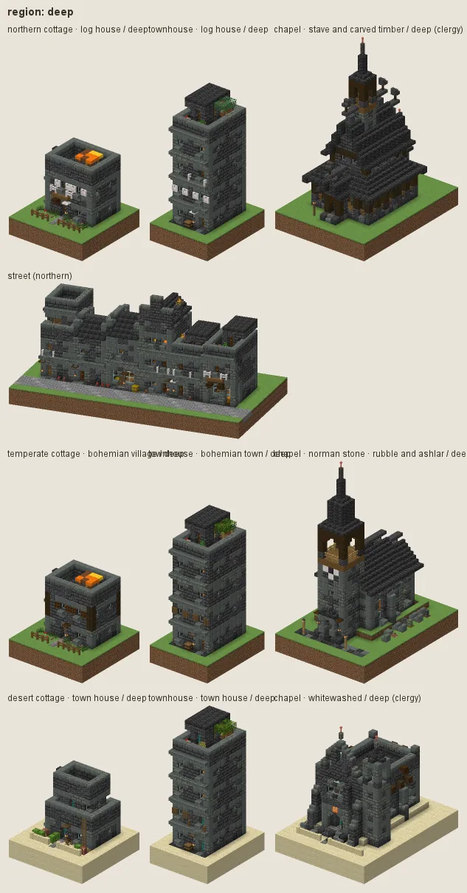

# Regional styles

A regional style is worn over whatever culture builds in its land (README §5): it names only the roles and habits it
changes, and the culture's geometry, its manners and everything the region leaves alone stand. The plot's biome (the
probe reads it at the plot's centre; the `biome` param stands in for it), a landform, or the `region` param chooses it;
`region=none` refuses it; with several matching the highest priority wins (the deep, 100, over any land above it).
Expanse's renamed biomes match by their old and new ids alike.

All regions but the deep are **natural**: real stone, real timber, real flowers. Glowing and fantasy materials (amber,
glowcaps) belong to the deep only.

| region | worn in | priority | names it also answers to | over (where the sim puts it) |
|---|---|---|---|---|
| old forest | `expanse:ancient_oakwood` (= `lumen_grove`), `minecraft:dark_forest` | 10 | `lumen`, `ancient_oakwood` | temperate, northern |
| glade | `expanse:woodland_glades` (= `wisteria_vale`), `minecraft:flower_forest` | 8 | `wisteria_vale`, `woodland_glades` | wisteria, temperate |
| cloud forest | `expanse:cloud_forest` | 10 | | tropical |
| volcanic | `expanse:volcanic_highlands` | 10 | | moorland, alpine |
| fjord | `expanse:fjordlands`, landform `fjord` | 10 | | maritime, northern |
| tepui | `expanse:tepui`, landform `tepui` | 10 | | tropical |
| deep | landform `underground` (a `realm` or `underground` param, or an underground archetype) | 100 | | any |

## Old forest (Ancient Oakwood)

The great oak and dark-oak wood: houses with a ground storey of mossy fieldstone (cobblestone, andesite and tuff, moss
low and on the north) under boarded upper storeys and gables of honey oak, dark oak frames and corners, roofs of dark oak
and spruce shingles green with moss, deep eaves (2) on brackets, oak shutters, a woodpile at every door, ferns, lily of the
valley and mushrooms in the gardens, dark oak in the hedges and yards. Variants: **oak frame** (dark oak timber frame with
oak-board panels, for ordinary houses) and **great hall** (mossy stone brick to the eaves under slate and mossy shingles,
for churches, public and grand buildings, forts and the gentry). It replaces the old *lumen* region (pale lumenwood,
teal shingles, sea lanterns), whose name the `region` param still accepts.

## Glade (Woodland Glades)

The sunny oak and birch glades once called Wisteria Vale: honey-coloured stripped-oak frames on white plaster, oak
windows, doors and fences, oak and birch floors, flower boxes on most windows (0.8), hedged yards of flowering azalea,
cottage gardens of poppies, cornflowers, daisies, bluets, alliums, peonies, roses, lilac, lavender and dandelions, oak and
birch trees, linen, yellow and green cloth. Roofs stay the culture's (red tile for the wisteria culture, shingles for
temperate).

## Cloud forest (monastic)

Mossy stone halls under deep bracketed eaves in the mist: mossy stone brick and cobble walls, white calcite gables, dark
oak timber galleries and lattices, hipped roofs of dark oak and slate thick with moss, ferns and orchids.

## Volcanic (highlands)

Tuff and basalt holds on blackstone footings: tuff-brick walls with polished tuff high and smooth basalt low, polished
blackstone quoins and plinths, slate roofs, cinnabar-red carved stone, gravel and ash paths, fireweed in the gardens.
Alpine towns there keep their timber upper storeys (the volcanic chalet variant).

## Fjord (Fjordlands)

Dark tarred boards (dark oak and spruce) on silvered poplar frames, white trim, turf roofs, boathouse gables to the water,
plank quays.

## Tepui

Lost-world hamlets on the table mountains: weathered tuff, cobble and andesite thick with moss, thatched cones and hipped
roofs under moss (aged thatch), palm-wood trim, ferns and orchids.

## Deep (underground towns)

The one fantastical region: halls of deepslate brick cut into the realm walls, polished tuff dressings, deepslate tile
roofs and flat parapets, deeproot timber, amber set in the stone as the accent, glowcaps and mushrooms in the pots,
lantern light.

---

Renders: `./gradlew -I docs/buildings/styles/styles_preview.gradle styleSheets -Pmode=regions -Pstyle=all` (the offline
renderer shows Expanse blocks as their vanilla stand-ins: deeproot as dark oak, amber as shroomlight, glowcaps as brown
mushrooms). Data: `src/main/resources/data/hearth/hearth_style/region/*.json`.
