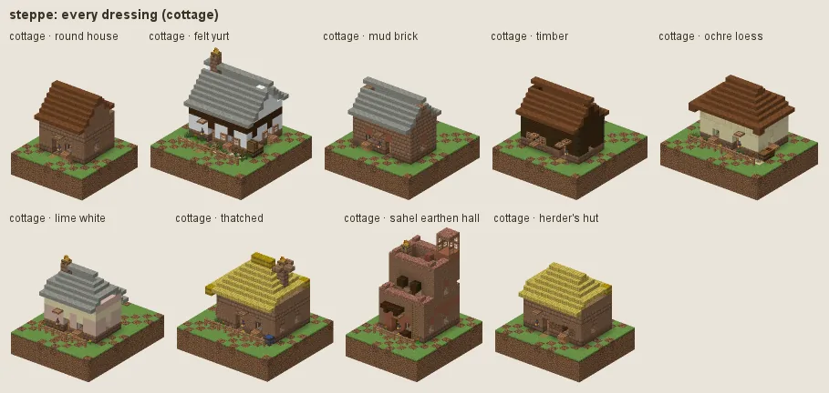
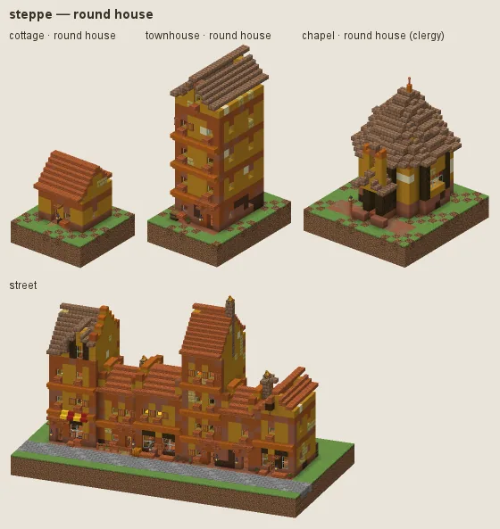
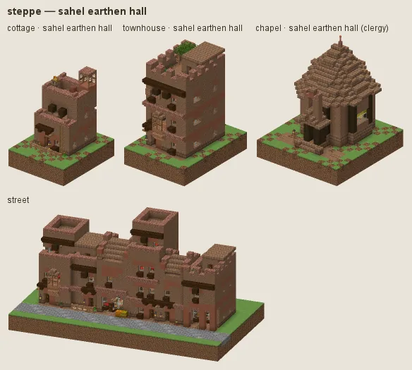
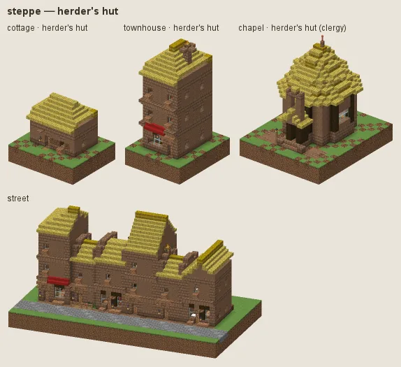

# Steppe: round houses, felt and earthen halls

The savanna, the steppe and the Sahel: round houses of mud plaster and dark timber under felt cones, felt yurts, mud-brick houses, market rings, earthen halls with vigas for the important buildings, herders' huts under grass thatch; palisades of debarked stakes. Earth, felt, undyed wool, mud brick and timber, not one orange terracotta (art review item 26).

## Manners

| dressing | worn by | walls | roof | built as |
|---|---|---|---|---|
| **round house** (common manner, w 2) | not (station gentry / lord or category religious / grand) | packed mud, mud bricks, coarse dirt at the foot | grey or brown felt (wool), dark oak trim | plaster |
| · felt yurt (w 1.4) | as the common manner | white felt, light grey felt | grey felt | plaster, always round, cone roof |
| · mud brick (w 1) | as the common manner | mud bricks, packed mud | · | brick |
| · timber (w 0.8) | as the common manner | dark oak boards | · | plank |
| · ochre loess (w 1) | as the common manner | smooth sandstone, sandstone, packed mud at the foot | · | plaster |
| · lime white (w 0.8) | as the common manner | white terracotta, smooth sandstone | · | plaster |
| · thatched (w 1) | as the common manner | · | hay block | plaster |
| **sahel earthen hall** (sub-style, w 7) | category religious / grand / public or station gentry / lord / official / merchant | packed mud, mud bricks, coarse dirt at the foot | packed mud, mud bricks | adobe |
| **herder's hut** (sub-style, w 3) | station poor or category farmstead | packed mud, mud bricks, coarse dirt at the foot | hay thatch | plaster |

A dash (·) keeps the material of the manner above. Weights compete among the dressings whose conditions hold (README §2).

### Round house

Mud plaster (packed mud, a patch of mud brick, earth at the foot) on mud-brick footings, dark timber, cone and hip roofs of felt (light grey or brown wool, one per house: white felt on a roof reads as snow). Baobab timber falls back to jungle wood (pale brown, as baobab is) without Expanse, not to orange acacia. Fashions: **felt yurt** (felt walls and roof, round), **mud brick** (terracotta dressings), **timber** (dark boards), **ochre loess** (a pale earth plaster, art review 2 item 15), **lime white** (dressed in smooth sandstone, not mud brick), **thatched** (grass thatch).

### Sahel earthen hall

For public and grand buildings, the gentry and merchants: packed mud with a little mud brick, terracotta lintels and copings (white terracotta read as pink spots), battered walls, vigas, flat roofs.

### Herder's hut

For the poor and farmsteads: mud walls under grass thatch.

**Walls (art review 2 item 6, audit L7).** Each dressing's wall is one material with at most a tonal second (under 10 %, in broad patches) and weathering only at the foot. Its `wall_accent` is one material, tonal with the wall but not the wall's own block: lintels, arch heads, quoins and copings are cut of it, so a contrasting accent dotted every window with a blotch (white on terracotta, terracotta and brown on white). No mixed accents.

## Finish by station and tier

Tier 0 is packed mud under hay; tier 3 limes the round house white (white terracotta) with white glazed-tile and carved tuff accents. Cloth is madder red, undyed white or brown, or weld yellow.

## Local materials

Local timber into frames and stakes. Working yards (category workshop) fell oak, not acacia.

## Still weak

Every defence work's palisade is debarked acacia stakes (an override): the grey acacia bark no longer shows.

---

Renders: `./gradlew -I docs/buildings/styles/styles_preview.gradle styleSheets -Pmode=dress -Pstyle=steppe` (every dressing), `-Pmode=stations`, `-Pmode=street`, `-Pmode=set`. Data: `src/main/resources/data/hearth/hearth_style/steppe.json`.
