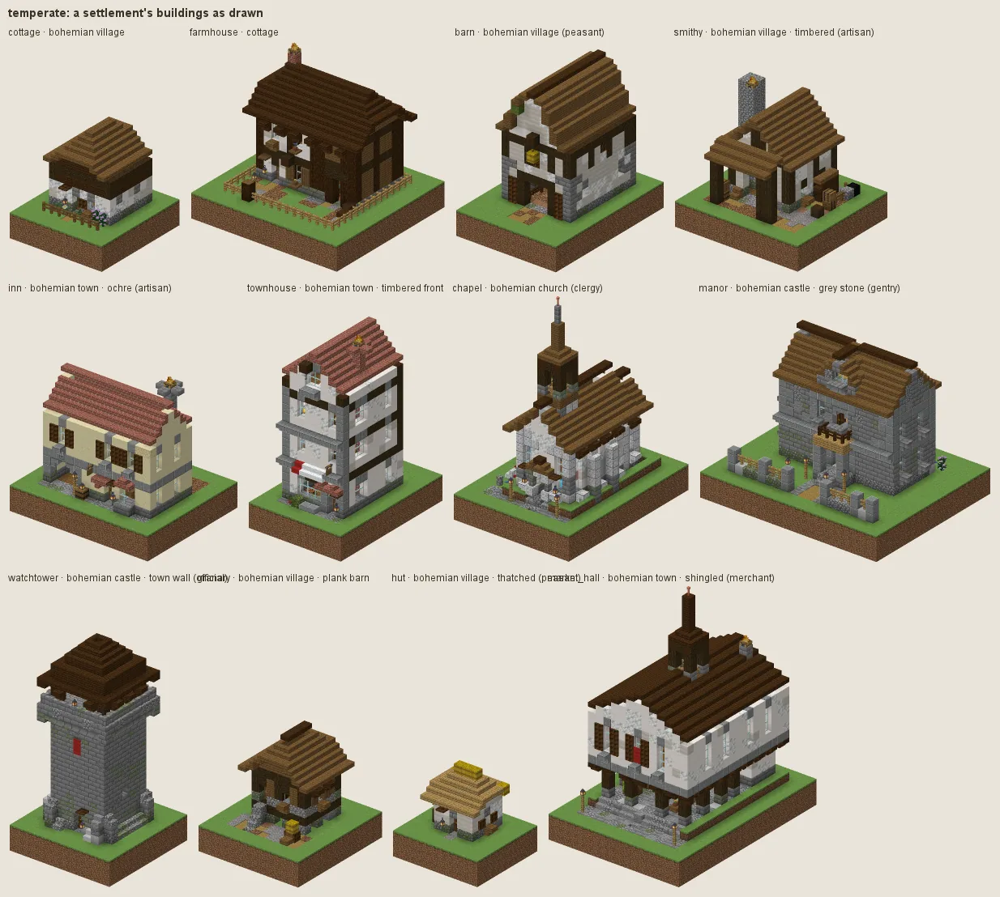
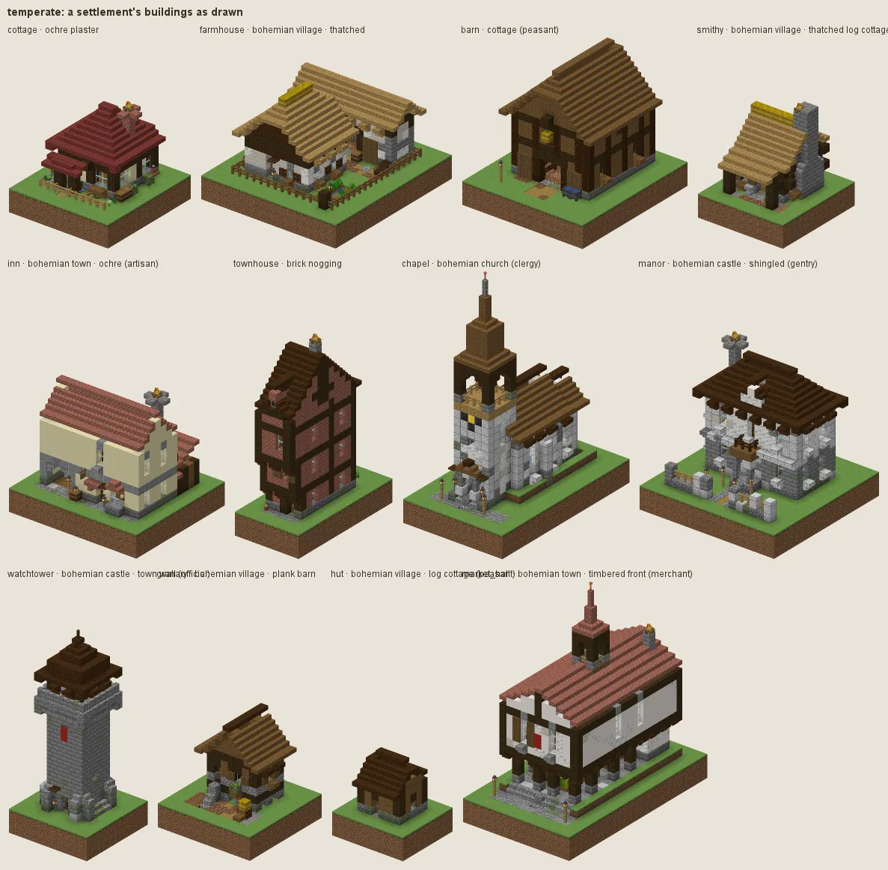
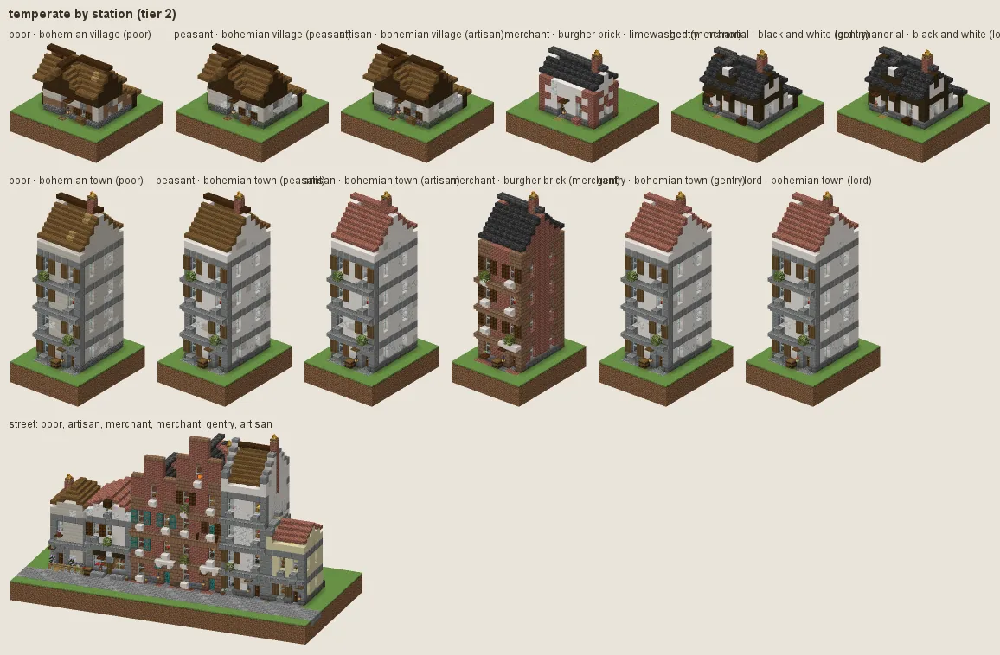
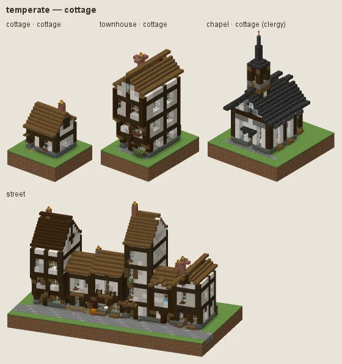
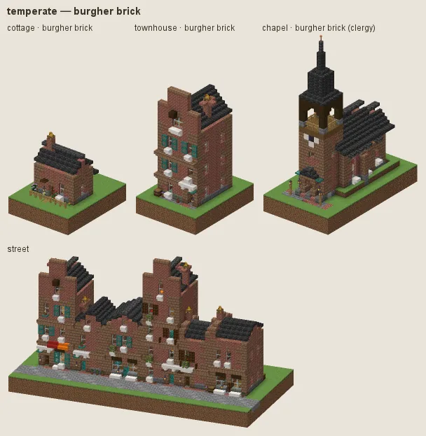
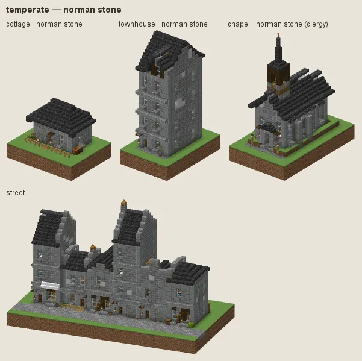
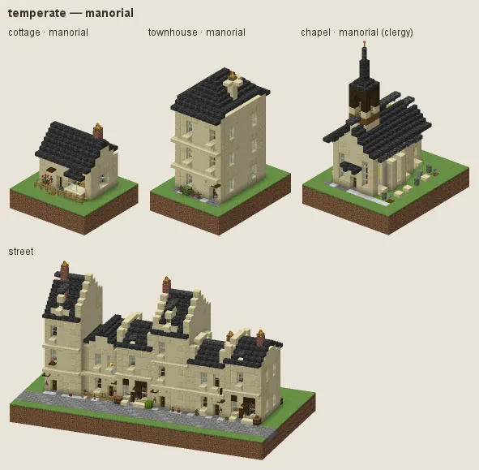
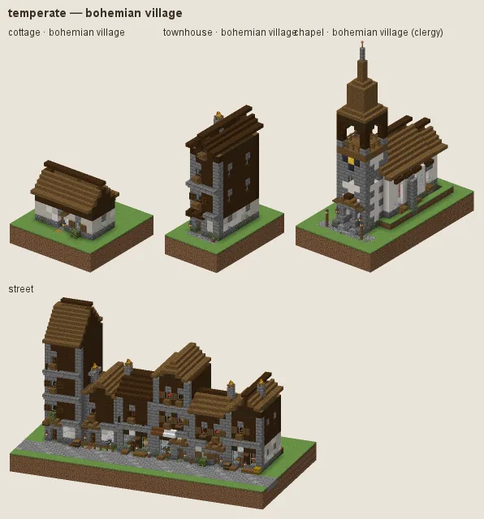
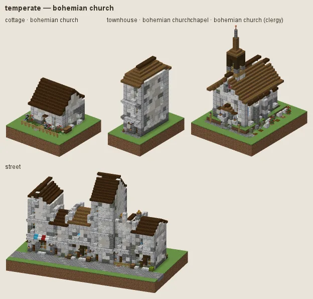

# Temperate: the Bohemian countryside

The temperate culture's main look is the Bohemia of *Kingdom Come: Deliverance II*, the visual target of Expanse's temperate lands: villages of lime-plastered cottages with dark boarded gables on fieldstone footings, log cottages, thatch and wooden shingle roofs, plank barns, a white stone church with a tall tower, market towns of rendered houses under red tile with their gables to the street, and castles and manors of rendered stone. The four Bohemian sub-styles carry nearly every building: about seven homes and workshops in eight, and at least 85 % of the churches, civic buildings, castles and manors (`StyleModelTest.stationsAndPurposesChooseTheDress` holds the shares; art review item 6). The older manners are the odd building among them, as a real countryside mixes builders and generations: the English timber-and-plaster cottage about one cottage in eight, Norman stone about one church or wall in ten (and the cathedral's and lighthouse's alternative), manorial about one manor in eight, burgher brick for warehouses and the odd merchant. No biome gates it: a temperate town reads Bohemian wherever it stands, in game and in every preview, so a town never changes manner at a river or a biome edge.

Palette logic: white lime render (mushroom stem for the rough village render and the church and castle render, smooth quartz for the dressed town render, a little calcite as the tonal second), dark timber (dark oak frames, spruce and dark oak boards), grey fieldstone (cobblestone, andesite, tuff, moss at the foot), brown shingles (spruce and dark oak, a little moss), aged thatch (hay ridges over oak-coloured slopes), red tile (bricks) in towns and castles. Contrast at thirty blocks comes from white walls against dark gables and roofs. Walls are one render with a tonal second in broad patches (under 10 %), weathering only at the foot and under the eaves; quoins and string courses on render are tonal (calcite, polished diorite), so a street reads white, not camouflage (art review item 2). Spires, helms and turret caps are sheathed in slate (deepslate tiles), now and then weathered copper, never a skyline of teal. House cloth is one natural dye per building: madder red, weld yellow, undyed white or brown (item 4).

## Bohemia at a glance

A settlement's buildings as the planner issues them, nothing forced: each archetype draws its own manner (the village manner for cottages, farmhouses, barns, smithies and inns, the town manner for town houses and the market hall, the church manner for the chapel, the castle manner for the manor and the watchtower), with the English manners turning up only now and then.

By station, the planner's `station` param on a cottage, a town house and a street (poor, peasant, artisan, merchant, gentry, lord):

## Manners

| dressing | worn by | walls | roof | built as |
|---|---|---|---|---|
| **cottage** (common manner, w 1) | not (station gentry / lord / merchant or category religious / fort / public / noble or archetype storage/warehouse) | mushroom stem, calcite at the foot, smooth quartz under the eaves | spruce, dark oak | timber frame |
| · brick nogging (w 0.5) | as the common manner | bricks | dark oak, spruce | timber frame |
| · ochre plaster (w 0.5) | as the common manner | smooth sandstone, sandstone at the foot | spruce, mangrove | timber frame |
| · rubble stone (w 0.5) | as the common manner | cobblestone, stone, andesite | dark oak, spruce | stone |
| · thatched (w 0.4) | as the common manner | · | hay block | timber frame |
| **burgher brick** (sub-style, w 5) | station merchant or category trade, tier 2+ or archetype storage/warehouse / commerce/counting_house | bricks, mud bricks at the foot | bricks | brick |
| · limewashed (w 1) | as burgher brick | smooth quartz, calcite (calcite quoins) | · | brick |
| · slate roof (w 0.8) | as burgher brick | · | deepslate tiles | brick |
| · brown brick (w 0.7) | as burgher brick | mud bricks, bricks | · | brick |
| **norman stone** (sub-style, w 1.5) | category religious / fort (not the monastery, convent, keep, castle) or archetype landmark/cathedral / landmark/lighthouse | stone bricks, stone, cracked and mossy at the foot | bricks | stone |
| · rubble and ashlar (w 1.5) | as norman stone | cobblestone, stone, andesite | · | stone |
| · tufa (w 0.6) | as norman stone | tuff bricks, tuff | · | stone |
| · slate roof (w 1) | as norman stone | · | deepslate tiles | stone |
| **manorial** (sub-style, w 2) | station gentry / lord or archetype house/manor / noble/palace / noble/hunting_lodge | smooth sandstone, sandstone at the foot | bricks | stone |
| · tudor brick (w 1) | as manorial | bricks, mud bricks | · | brick |
| · black and white (w 0.8) | as manorial | smooth quartz, calcite | deepslate tiles | timber frame |
| **bohemian village** (sub-style, w 20) | not (station gentry / lord / merchant or category religious / fort / noble / public or the urban house types, the town hall, the warehouse, the university) | mushroom stem, calcite at the foot, smooth quartz under the eaves | spruce, dark oak, moss block patches | plaster, boarded gable |
| · timbered (w 1.2) | as bohemian village | · | · | timber frame |
| · log cottage (w 1) | as bohemian village | spruce | · | log |
| · thatched log cottage (w 0.8) | as bohemian village | spruce | · | log |
| · fieldstone (w 1) | as bohemian village | cobblestone, andesite, stone | · | stone under plaster |
| · thatched (w 1.2) | as bohemian village | · | · | plaster |
| · whitewashed (w 1) | as bohemian village | · | · | plaster, rendered gable |
| · plank barn (w 8) | category farmstead | · | · | plank |
| **bohemian town** (sub-style, w 30) | station merchant / official or category trade, tier 2+ or category civic / law (not fort or religious) or archetypes landmark/clock_tower, civic/town_hall, commerce/counting_house, commerce/market_hall, commerce/bank, the urban house types... | smooth quartz, calcite, mushroom stem at the foot | bricks | plaster |
| · ochre (w 1.4) | as bohemian town | smooth sandstone, sandstone at the foot | · | plaster |
| · timbered front (w 1) | as bohemian town | · | · | plaster under timber frame |
| · shingled (w 1.2) | as bohemian town | · | spruce, dark oak | plaster |
| **bohemian church** (sub-style, w 14) | category religious or archetype landmark/bell_tower | mushroom stem, calcite, smooth quartz under the eaves, stone at the foot | dark oak, spruce, moss block patches | stone |
| · fieldstone (w 1.2) | as bohemian church | cobblestone, stone, andesite | · | stone |
| · slate (w 1) | as bohemian church | · | deepslate tiles, cracked deepslate tiles | stone |
| · red tile (w 0.8) | tier 3+ | · | bricks | stone |
| **bohemian castle** (sub-style, w 14) | category fort / noble or station gentry / lord or archetype house/manor / landmark/great_hall | mushroom stem, calcite, smooth quartz under the eaves, cobblestone at the foot | bricks | stone |
| · grey stone (w 1.2) | as bohemian castle | stone bricks, cobblestone, andesite | dark oak, spruce | stone |
| · town wall (w 2.5) | category fort | cobblestone, stone, andesite | dark oak, spruce | stone |
| · shingled (w 0.8) | as bohemian castle | · | dark oak, spruce | stone |
| · ochre render (w 0.6) | as bohemian castle | smooth sandstone, sandstone at the foot | · | stone |
| · lime over rubble (w 1.6) | category noble | smooth quartz, calcite (diorite quoins) | bricks | stone |
| · ochre and tile (w 1.2) | category noble | smooth sandstone, sandstone at the foot | bricks | stone |

A dash (·) keeps the material of the manner above. Weights compete among the dressings whose conditions hold (README §2).

### Cottage

The English cottage: dark oak frames on white plaster over a stone plinth, jetties, braces, spruce shingles, cottage gardens. About one cottage in eight; its fashions are brick nogging, ochre plaster, rubble stone and golden thatch.

### Burgher brick

Hanseatic brick for merchants and the market: brick fronts with stepped or plain gables to the street, dressed quoins, slate roofs, tall windows. Burgher brick dresses the warehouses and about one merchant's house in eight; the town hall is Bohemian.

### Norman stone

Coursed stone for churches, keeps and walls, slate roofs, arched windows; rubble-and-ashlar and tufa fashions. About one church or wall in ten, and the cathedral's and the lighthouse's alternative (grey gothic).

### Manorial

The English manor: honey ashlar, Tudor brick or black-and-white timber for the gentry. About one gentry house in eight beside the Bohemian castle manner.

### Bohemian village

The heart of it. A cottage is rendered to the eaves (rough lime, grey at the foot, whiter under the eaves) on a course of fieldstone, with the dark boarding kept to the gable, roofed in spruce or dark oak shingles with a little moss; half-hip and gable roofs, the gable often to the lane, a covered porch, small shuttered windows (one block high), a kitchen garden, a woodpile. Fashions: **timbered** (dark frames with white infill, the richer farmhouse), **log cottage** (hewn spruce logs, dark corners, a whitewashed gable), **thatched log cottage**, **fieldstone** (a rubble ground storey with dressed corners under render), **thatched** (aged thatch, hay at the ridge over oak-brown slopes, mossy), **whitewashed** (rendered to the eaves, half-hip roof) and, for farmsteads only, the **plank barn** (vertical spruce boards, weathered dark at the foot, on fieldstone). Never worn by the gentry, merchants, churches, forts or the urban house types.

### Bohemian town

The market town (Kuttenberg, Rattay): houses of rendered masonry with their gables to the street, white or ochre lime-wash, a stone-brick plinth, calcite string courses (tonal, so the render reads whole), polished andesite window dressings, steep red tile roofs with dormers, tall windows, chimneys of brick. Fashions: **ochre**, **timbered front** (a jettied timber-framed upper storey over the rendered ground floor) and **shingled** (wooden shingles instead of tile, the poorer street). Worn by merchants and officials, trade buildings from tier 2, every civic and law building that is not a church or a fort (the town hall, library, school, infirmary, courthouse...), the clock tower, the bank, the market hall, and the town house types (town house, row house, tenement, shophouse).

### Bohemian church

The parish church and the bell tower: white lime render over stone, quoins, buttresses and window tracery in pale dressed stone (polished diorite) going to grey stone brick at the foot, arched windows, a plinth of mossy stone brick, a dark shingle roof and tower cap, sheathed in slate (the `sheet` role) (the tower is the archetype's: a squat west tower under a pyramidal helm or an onion in a village, a tall one with a timber gallery under a helm or an onion in a town, the caps dark shingle or slate whatever the nave wears). Fashions: **fieldstone** (bare rubble walls with grey stone-brick dressings), **slate** (deepslate roof) and, from tier 3, **red tile**.

### Bohemian castle

Castles, manors and the gentry's houses (Rattay, Talmberg): rendered stone in white lime with pale dressed-stone quoins and window surrounds, a little rubble at the foot where the render has fallen, red tile roofs, hipped and gabled, dormers, bay windows. Fashions: **grey stone** (bare coursed stone under dark shingles, Talmberg), **town wall** (rubble walls with stone-brick dressings under shingles, for the defence works only, and the dress a temperate town's walls and towers wear unless the planner gives the town a seed of its own), **shingled**, **ochre render**, and for noble seats **lime over rubble** and **ochre and tile**.

## Finish by station and tier

Tiers 0 to 4 change finish inside every manner. The Bohemian village at tier 0 is daubed rather than limed (packed mud at the foot of mushroom-stem render; the English cottage's hovels are limed daub too) under old dark shingles patched with moss; tier 1 is mossier shingles; tier 3 is fresh white render (smooth quartz) on a dressed stone-brick plinth; tier 4 roofs in red tile. The town at tiers 0 and 1 roofs in shingles. With an explicit `station` the finish moves (README §3): a poor household lives at tier 0 with its roof mended in patches, a merchant a tier up, a lord two tiers up with copper lanterns.

## Local materials

Timber and stone of the territory go into the village: a birch wood gives hewn birch log walls, birch floors and boards and hewn (stripped) birch posts, never bark on the surface (frames stay dark oak), a limestone quarry gives limestone footings and fieldstone walls with the same grading (rubble stays rubble, dressed plinths become the stone's dressed blocks). Roofs, render, doors and shutters are the culture's own.

## Still weak

The renders force each dressing on every archetype; in play a manner only dresses what its condition allows (no village manner on a town house, no castle manner on a cottage). Tower caps are the archetypes' (`kit/civic/Bohemian`: dark helms and onions, no copper needles), and stepped gables and arcades are geometry the stage B town houses still have to build: the town manner gives them the materials. Small cottages in the stone manners show a lot of quoin for their size.

---

Renders: `./gradlew -I docs/buildings/styles/styles_preview.gradle styleSheets -Pmode=dress -Pstyle=temperate` (every dressing), `-Pmode=stations`, `-Pmode=street`, `-Pmode=set`. Data: `src/main/resources/data/hearth/hearth_style/temperate.json`.
