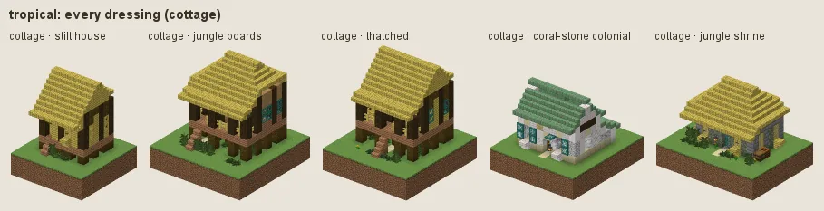
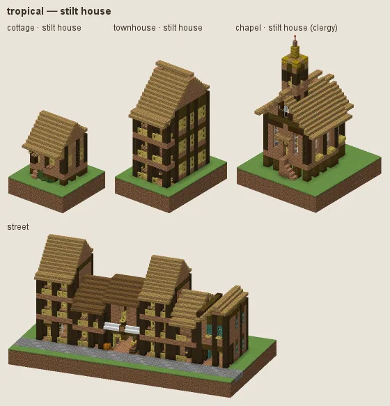
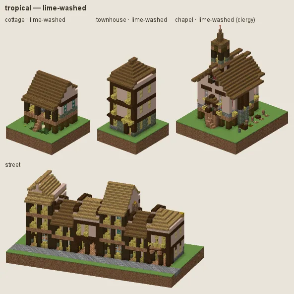
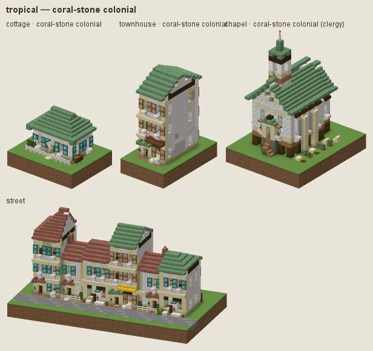
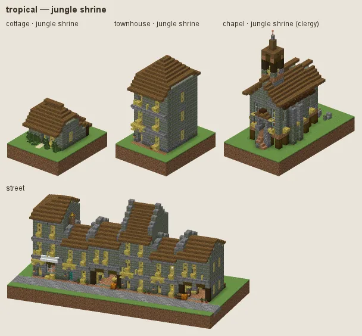

# Tropical: stilt houses under thatch

Southeast Asia, the Pacific and the Caribbean coast: houses of palm boards on stilts under deep hipped palm thatch, bamboo screens and lattices, lime-washed houses, lattice openings, coral-stone colonial houses for merchants and the gentry, mossy jungle shrines.

## Manners

| dressing | worn by | walls | roof | built as |
|---|---|---|---|---|
| **stilt house** (common manner, w 2) | not (station gentry / lord or category religious) | palm boards (jungle without Expanse) | palm thatch: dark (spruce), oak-brown, or fresh straw, one per house | plank |
| · jungle boards (w 1) | as the common manner | jungle | · | plank |
| · lime-washed (w 0.8) | as the common manner | white terracotta, moss at the foot | · | plaster on a rubble plinth |
| · thatched (w 1) | as the common manner | · | hay ridge over oak-brown slopes | plank |
| **coral-stone colonial** (sub-style, w 8) | station merchant / official / gentry / lord or archetype civic/town_hall / commerce/bank / commerce/inn / house/manor / commerce/market_hall | calcite, smooth quartz, diorite | bricks, weathered cut copper | plaster under plank |
| **jungle shrine** (sub-style, w 6) | category religious | mossy stone bricks, stone bricks, mossy cobblestone | dark palm thatch, moss block patches | stone |

A dash (·) keeps the material of the manner above. Weights compete among the dressings whose conditions hold (README §2).

### Stilt house

Palm boards (jungle in previews without Expanse) between dark posts and girts on stilts, deep hipped roofs of palm thatch in three tones (dark, oak-brown, fresh straw), chosen per house, so a town reads in two or three roof colours and not one straw yellow from afar (art review 2 item 15). Bamboo is kept for screens: lattice windows, doors, shutters, fences, rails and furniture; never a wall (audit L7: the lemon-yellow bamboo-plank walls). Fashions: **jungle boards** (darker), **lime-washed** (white lime render over rubble, the third wall colour of a town), **thatched** (thatch-form roofs).

### Coral-stone colonial

White coral render on a stone storey under boarded galleries, tile or patinated copper roofs.

### Jungle shrine

Mossy stone brick under dark palm thatch and moss, dressed in stone brick.

## Finish by station and tier

Tier 0 is rough jungle boards under oak-brown or dark thatch; tier 3 has dark trim.

## Local materials

Local timber into boards and stilts.

## Still weak

Palm boards are pale tan; without Expanse they fall back to jungle (pink-brown). The lattice and bamboo screens still read yellow up close, by design.

---

Renders: `./gradlew -I docs/buildings/styles/styles_preview.gradle styleSheets -Pmode=dress -Pstyle=tropical` (every dressing), `-Pmode=stations`, `-Pmode=street`, `-Pmode=set`. Data: `src/main/resources/data/hearth/hearth_style/tropical.json`.
