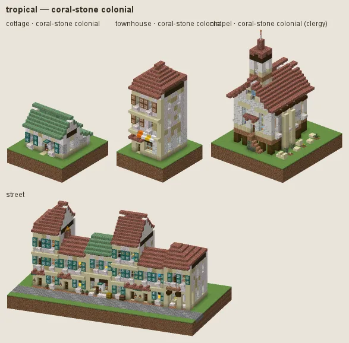
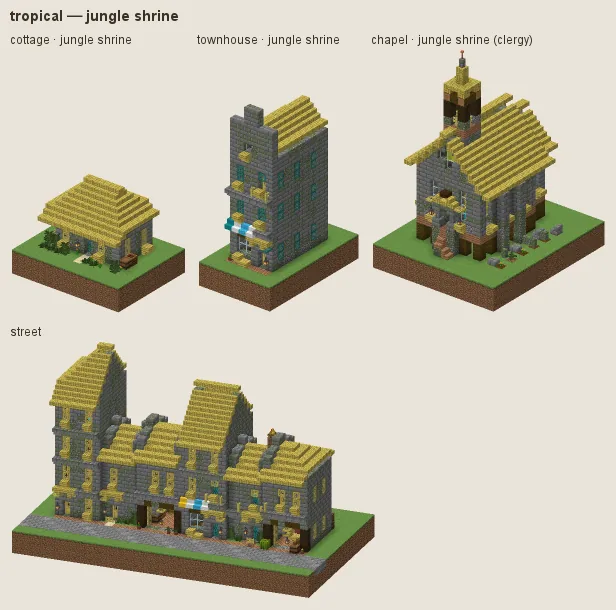

# Tropical: stilt houses under thatch

Southeast Asia, the Pacific and the Caribbean coast: houses of palm wood and bamboo on stilts under deep hipped thatch, lattice openings, coral-stone colonial houses for merchants and the gentry, mossy jungle shrines.

## Manners

| dressing | worn by | walls | roof | built as |
|---|---|---|---|---|
| **stilt house** (common manner, w 2) | not (station gentry / lord or category religious) | bamboo planks, jungle | bamboo mosaic, bamboo planks | plank |
| · jungle boards (w 1) | as the common manner | jungle | · | plank |
| · thatched (w 1) | as the common manner | · | hay block | plank |
| **coral-stone colonial** (sub-style, w 8) | station merchant / official / gentry / lord or archetype civic/town_hall / commerce/bank / commerce/inn / house/manor / commerce/market_hall | calcite, smooth quartz, diorite | bricks, weathered cut copper | plaster under plank |
| **jungle shrine** (sub-style, w 6) | category religious | mossy stone bricks, stone bricks, mossy cobblestone | bamboo mosaic, moss block patches | stone |

A dash (·) keeps the material of the manner above. Weights compete among the dressings whose conditions hold (README §2).

### Stilt house

Bamboo and palm (jungle in previews) boards on stilts, deep hipped roofs of bamboo mosaic. Fashions: **jungle boards**, **thatched** (bright palm thatch).

### Coral-stone colonial

White coral render on a stone storey under boarded galleries, tile or patinated copper roofs.

### Jungle shrine

Mossy stone brick under thatch and moss.

## Finish by station and tier

Tier 0 is bamboo under hay thatch; tier 3 has dark trim.

## Local materials

Local timber into boards and stilts.

## Still weak

The bright bamboo thatch stays here (palm and grass thatch is pale in the tropics); in the temperate cultures thatch is aged and oak-brown.

---

Renders: `./gradlew -I docs/buildings/styles/styles_preview.gradle styleSheets -Pmode=dress -Pstyle=tropical` (every dressing), `-Pmode=stations`, `-Pmode=street`, `-Pmode=set`. Data: `src/main/resources/data/hearth/hearth_style/tropical.json`.
