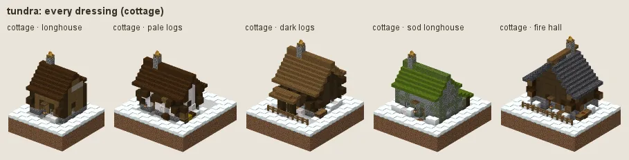
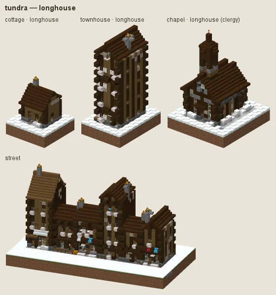
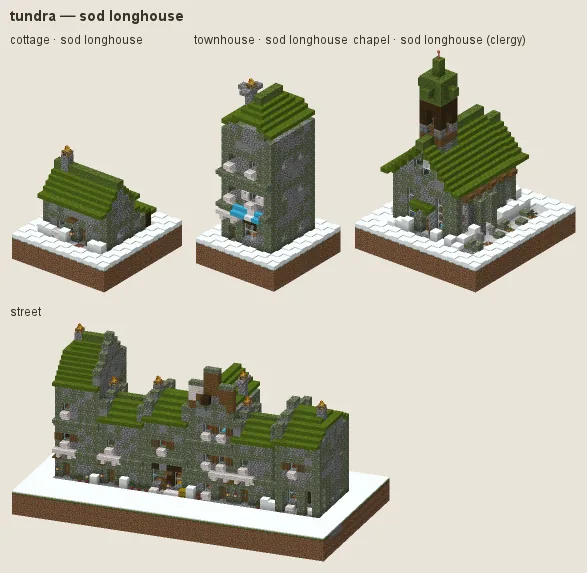
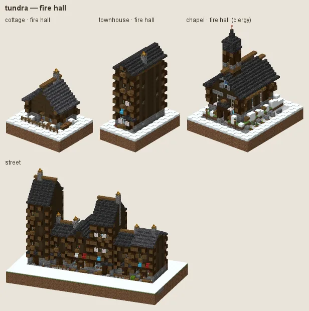

# Tundra: longhouses in the snow

Arctic and subarctic: low spruce longhouses banked in snow, steep dark roofs, white trim, lantern light; sod longhouses for the poor; dark fire halls for the community.

## Manners

| dressing | worn by | walls | roof | built as |
|---|---|---|---|---|
| **longhouse** (common manner, w 2) | not (station gentry / lord or category religious / grand) | spruce, poplar | dark oak, spruce | log |
| · pale logs (w 1) | as the common manner | pale oak | · | log |
| · dark logs (w 1) | as the common manner | dark oak | spruce | log |
| **sod longhouse** (sub-style, w 3) | station poor / peasant or category farmstead | cobblestone, mossy cobblestone, andesite | moss block | stone |
| **fire hall** (sub-style, w 6) | category religious / grand / public or station gentry / lord / official | dark oak | deepslate tiles, cobbled deepslate | log |

A dash (·) keeps the material of the manner above. Weights compete among the dressings whose conditions hold (README §2).

### Longhouse

Spruce logs with poplar highlights, dark roofs, small windows. Fashions: **pale logs**, **dark logs**.

### Sod longhouse

Fieldstone and turf for the poor and farmsteads.

### Fire hall

Dark oak log halls under slate for public buildings and the gentry.

## Finish by station and tier

Tier 0 is mossy spruce shingles; tier 3 slate.

## Local materials

Local timber becomes hewn log walls.

---

Renders: `./gradlew -I docs/buildings/styles/styles_preview.gradle styleSheets -Pmode=dress -Pstyle=tundra` (every dressing), `-Pmode=stations`, `-Pmode=street`, `-Pmode=set`. Data: `src/main/resources/data/hearth/hearth_style/tundra.json`.
