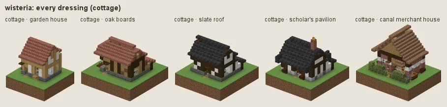
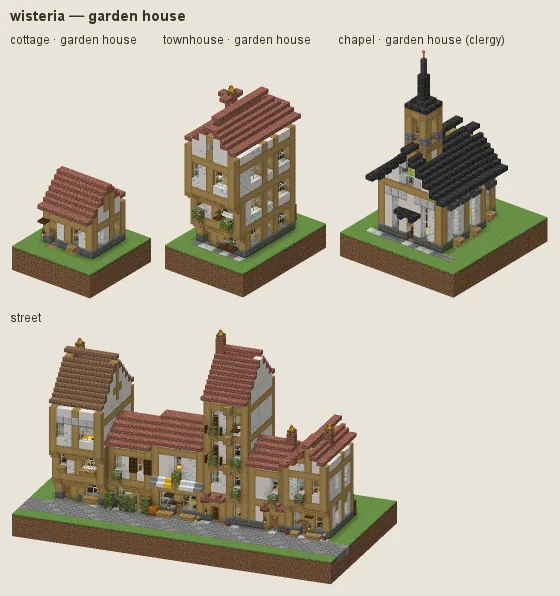
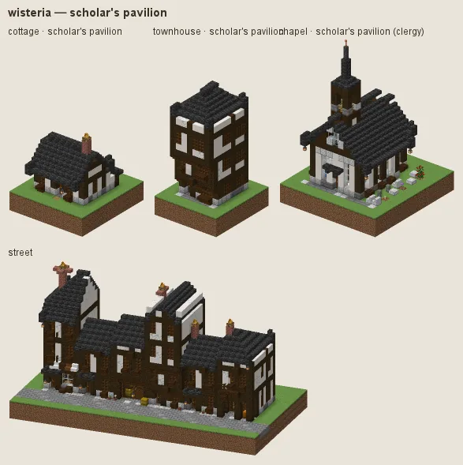
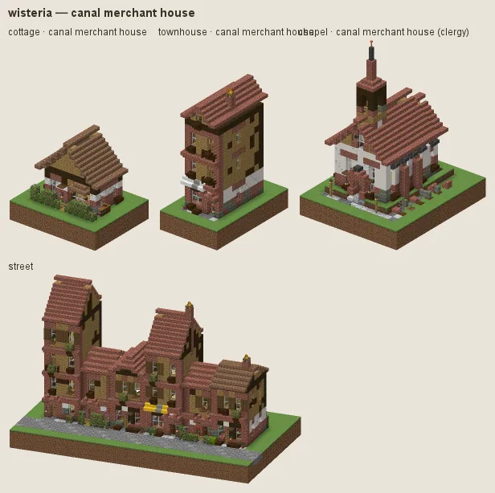

# Wisteria: the Woodland Glades

The wisteria culture builds in the Woodland Glades (once Wisteria Vale) and in cherry groves. It used to build in purple wisteria wood and pink cherry; on the natural surface it is now a refined garden-village manner in nature's colours: honey-coloured oak frames (stripped oak logs) and white plaster under red clay tile, half-hip and hipped roofs, flower boxes, hedges of flowering azalea, cottage gardens of poppies, cornflowers, daisies, peonies, roses, lilac and lavender, oak and birch in the yards. Think Alsace or the Cotswolds in May.

## Manners

| dressing | worn by | walls | roof | built as |
|---|---|---|---|---|
| **garden house** (common manner, w 2) | not (station gentry / lord / scholar or category religious) | calcite, smooth quartz | bricks, mud bricks | timber frame |
| · oak boards (w 1) | as the common manner | oak, spruce | · | plank |
| · slate roof (w 1) | as the common manner | · | deepslate tiles | timber frame |
| **scholar's pavilion** (sub-style, w 7) | station scholar / gentry / lord / clergy or category religious or archetype civic/library / civic/school / house/manor | smooth quartz, calcite | deepslate tiles, cracked deepslate tiles | timber frame |
| **canal merchant house** (sub-style, w 8) | station merchant / official or category home / trade, district market / harbour | smooth quartz, calcite | bricks, mud bricks | plaster under plank |

A dash (·) keeps the material of the manner above. Weights compete among the dressings whose conditions hold (README §2).

### Garden house

Honey oak frames, closely spaced (two-block bays), white plaster infill, red tile roofs, half-hips, flower boxes on most windows, hedged gardens. Fashions: **oak boards** (boarded walls under dark oak frames) and **slate roof**.

### Scholar's pavilion

For scholars, the clergy and the gentry: smooth white walls between dark oak posts, deep hipped roofs in slate with brackets and gently lifted corners, lattice windows, raked gravel gardens, verandas.

### Canal merchant house

For merchants and the market or harbour: a brick plinth and white render under boarded oak upper storeys, jetties and balconies over the street, flower boxes everywhere, red tile.

## Finish by station and tier

Tier 0 is packed mud and calcite under brick and mud-brick tile mended with moss; tier 3 roofs in slate.

## Local materials

Local timber and stone blend as for every culture (README §4); light local woods go into boards and floors, never the frames. Working yards (category workshop) fell oak only.

## Still weak

The pavilion's flared roof is a habit of the roof kit; it reads more East Asian than the rest of the culture.

---

Renders: `./gradlew -I docs/buildings/styles/styles_preview.gradle styleSheets -Pmode=dress -Pstyle=wisteria` (every dressing), `-Pmode=stations`, `-Pmode=street`, `-Pmode=set`. Data: `src/main/resources/data/hearth/hearth_style/wisteria.json`.
